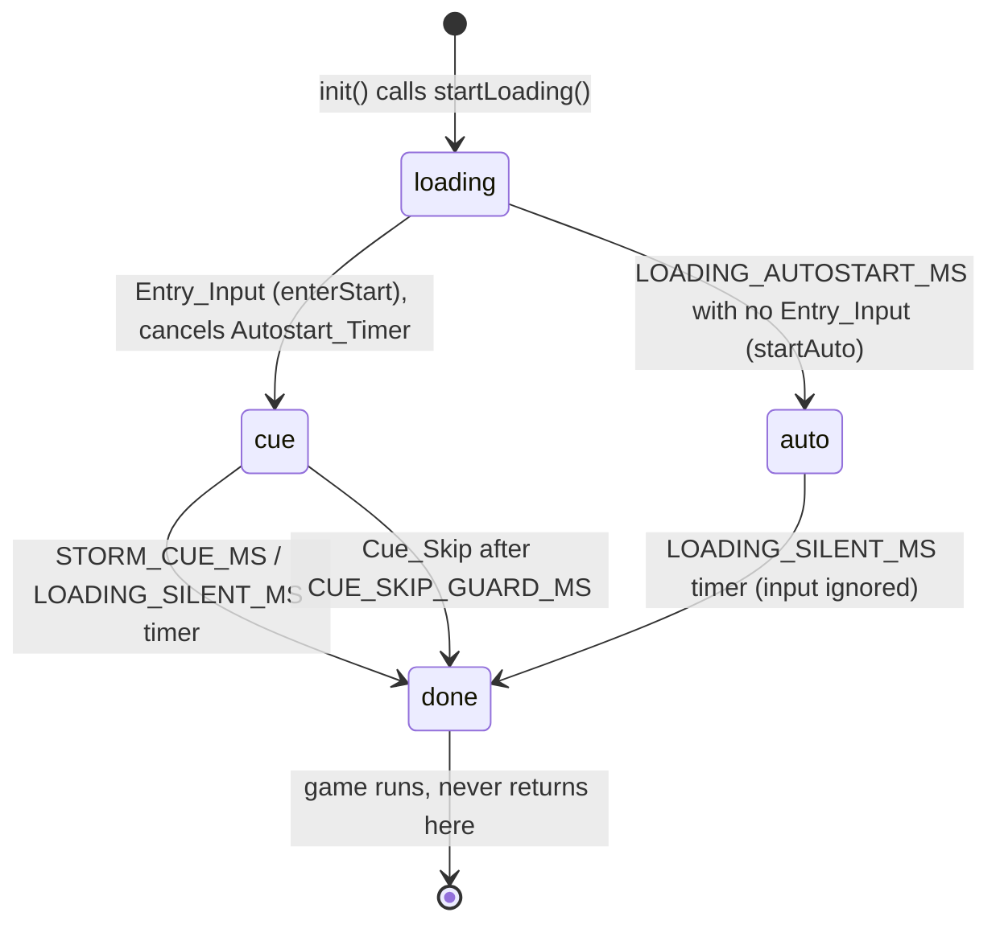
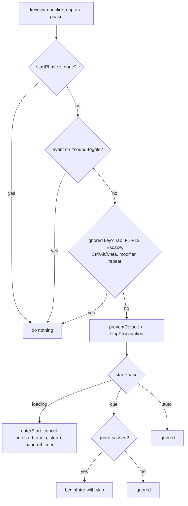
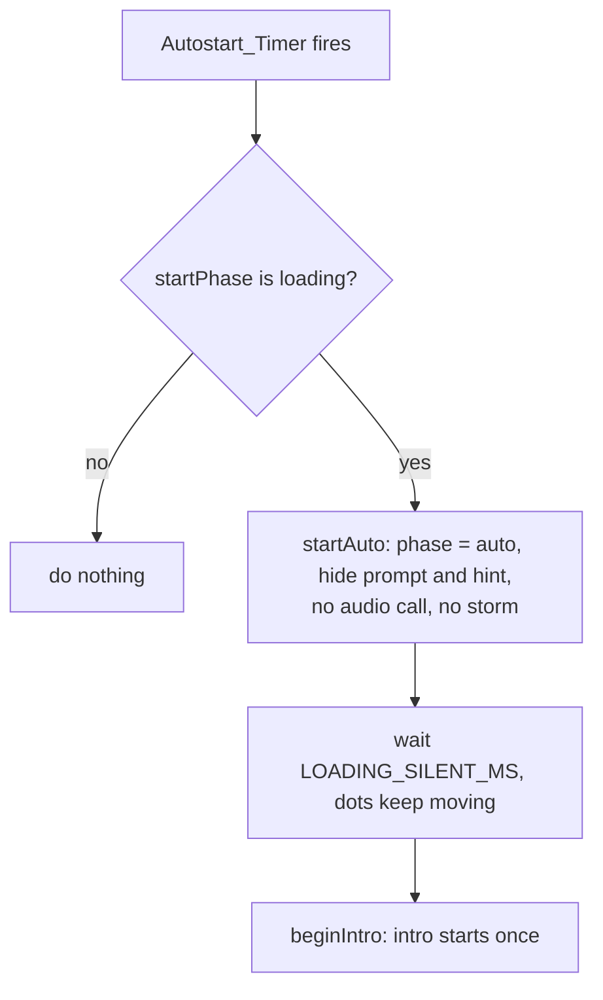
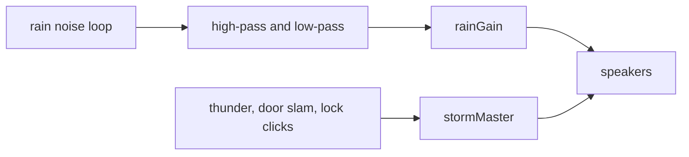

# Design Document

## Overview

This design replaces the typed green boot screen with a cinematic start sequence. It changes presentation only. `processCommand`, `runCommand`, `INITIAL_STATE`, fear, hints and the lying narrator are not touched.

The sequence has three parts:

1. A black loading screen with the word LOADING and animated dots. After 1.5 seconds it shows a blinking prompt and a dim skip hint. A safety timer (the Autostart_Timer) starts at page load.
2. After the first key press or tap (the Entry_Input), a synthesized storm cue plays: rain, distant thunder, close thunder, a door slam and a lock click. The loading screen stays up the whole time. The Entry_Input cancels the Autostart_Timer.
3. After 5 seconds (or a skip after an 800 ms guard), the loading screen goes away and the existing intro is typed with the same `showLines` call that `finishBoot` makes today.

If nobody presses anything for 15 seconds, the Autostart_Timer fires. The page then takes a silent path: the prompt lines vanish, the loading screen stays for 2 more seconds with all input ignored, and the intro starts. No storm plays and the audio context is never touched.

Design decisions:

| Decision | Choice | Reason |
|---|---|---|
| How to "cover" the Output_Area | The `#output` element is wrapped in a new `#output-wrap` div. The wrapper is `position: relative` and takes the flex space that `#output` used to take. A new `#loading-screen` div sits inside the wrapper, absolutely positioned with `top/right/bottom/left: 0`. While `body` has the class `starting`, the overlay is shown and `#output` is `visibility: hidden`. | The overlay is sized by the wrapper, so it matches the Output_Area exactly. It uses no offset and no height for the Status_Bar, so it still fits when the Status_Bar wraps onto several lines on a 320 px phone (Requirements 2.1, 2.13). The overlay is not placed inside `#output` itself, because `#output` scrolls and an absolute child would scroll away with the content. |
| Start state | One variable `startPhase` with four values: `"loading"`, `"cue"`, `"auto"`, `"done"`. It replaces `bootPhase`. | Easy for a beginner to follow. `"cue"` is the wait after an Entry_Input (storm or silent). `"auto"` is the silent wait after the Autostart. `"done"` means the game runs. |
| Hand-off | One function `beginIntro` that only works when `startPhase` is `"cue"` or `"auto"`, then sets `"done"`. | A skip, the hand-off timer and the Autostart can fire together, and the intro still starts once (Requirement 4.12). |
| Autostart | `autostartTimer` is set in `startLoading()` with `LOADING_AUTOSTART_MS`. `enterStart` clears it. When it fires in phase `"loading"`, `startAuto()` runs the silent path. | One timer, one cancel point (Requirements 3.10, 4.13 to 4.17). |
| Input during the silent waits | Phase `"auto"` ignores every key and tap for Entry_Input and Cue_Skip. Phase `"cue"` with sound off (the player already pressed a key) still accepts a Cue_Skip after the 800 ms guard, exactly like the storm case. | Requirement 4.16 forbids skipping only in the Autostart wait. Requirement 4.5 allows a skip after any Entry_Input. This resolves the earlier open point. |
| Storm sounds | A separate set of `storm` functions. They build Web Audio nodes directly and do not use `playSound`. | `playSound` has the 25 ms gap rule and makes one beep. The storm needs overlapping layered sounds (Requirement 5.11). |
| Two output buses | Thunder, door slam and lock clicks go through `stormMaster`. The rain goes through its own `rainGain` straight to the speakers. | A skip must stop the effects in 200 ms but fade the rain over 1.5 s (Requirements 6.6 to 6.8). Separate buses let each fade independently. |
| Loudness | Every peak is `SOUND_VOLUME * STORM_PEAK_MAX * factor`, with a factor from 0 to 1. The door slam uses factor 1 (the cap). Close thunder uses `CLOSE_THUNDER_FACTOR` (0.8), distant thunder uses `DISTANT_THUNDER_FACTOR` (0.4). | One cap, one helper, no way to go above it (Requirements 5.2, 5.13 to 5.16). |
| Scheduling the storm | All events are scheduled up front on the audio clock, and every effect source is kept in a list. Stopping fades the master gain node and stops every source. | One stop path serves the skip, the sound toggle and the mute commands (Requirements 5.10, 6). |
| Loading word size | Applied from JavaScript with constants: `clamp(32px, 8vw, 72px)`. | Requirement 1 wants the numbers as named constants, not repeated in CSS. |
| Silent entry | When sound is off at the Entry_Input, the loading screen stays for `LOADING_SILENT_MS`. A skip after the guard also ends it early. | One code path for both cases (Requirements 4.5, 4.8). |

Research notes (Web Audio, from MDN):

- Browsers only allow audio after a user action. The Entry_Input is that action, so the context is created or resumed inside the key or click handler. See the [MDN autoplay guide](https://developer.mozilla.org/en-US/docs/Web/Media/Guides/Autoplay). The Autostart is not a user action, so it never touches the context.
- `AudioBufferSourceNode` with `loop = true` plays a short noise buffer forever. A source can be stopped with `stop(time)`, and stopping a source that has not started yet means it never plays. See the [MDN Web Audio API overview](https://developer.mozilla.org/en-US/docs/Web/API/Web_Audio_API).
- `exponentialRampToValueAtTime` cannot ramp to exactly 0, so the code ramps to 0.0001 (the existing `playSound` does the same). `linearRampToValueAtTime` can reach 0.
- Content was rephrased from the MDN pages for compliance with licensing restrictions.

## Architecture

Everything stays in the three existing files. The sequence is a thin layer on top of the page. It runs before the game and hands over once.







Layers:

| Layer | Owns | Never touches |
|---|---|---|
| Start sequence (new) | `startPhase`, loading screen, dots, prompt timer, autostart timer, hand-off timer | `gameState`, `INITIAL_STATE`, `processCommand`, `runCommand` |
| Storm engine (new, inside the sound engine area) | Audio nodes for the cue | `gameState`, `playSound`'s gap rule |
| Existing sound engine | `ensureAudio`, `setSound`, `playSound` | unchanged, except one added line in `setSound` |
| Existing typewriter | `showLines`, `typing`, `skipTyping` | unchanged |

## Components and Interfaces

### index.html

Add `class="starting"` to `<body>` (so the output is never shown before the script runs). Wrap `#output` in `#output-wrap` and put the loading screen inside the wrapper, before `#output`:

```html
<body class="starting">
  <div id="status-bar"> ... unchanged ... </div>

  <!-- Wrapper: sized like the output area. The loading screen covers exactly this box. -->
  <div id="output-wrap">

    <!-- Loading screen: shown until the start sequence hands over to the intro -->
    <div id="loading-screen">
      <div id="loading-title">
        <span id="loading-word">LOADING</span><span id="loading-dots"></span>
      </div>
      <div id="loading-prompt" class="loading-hidden">PRESS ANY KEY OR TAP TO ENTER</div>
      <div id="loading-hint" class="loading-hidden">Press Enter or tap to skip typed text.</div>
    </div>

    <div id="output"> ... unchanged ... </div>
  </div>
```

`#output` keeps its id and its contents, so every `getElementById("output")` in game.js keeps working.

### style.css

Replace the `.boot-line` rule. Everything else stays, except that the `flex: 1` job of `#output` is shared with the wrapper (see the first two rows).

| Rule | What it does |
|---|---|
| `#output-wrap { position: relative; flex: 1; min-height: 0; display: flex; flex-direction: column; }` | Takes the space that `#output` took before. `position: relative` makes it the anchor for the overlay. `min-height: 0` lets `#output` keep scrolling inside it. |
| `#output` keeps its current rules (`flex: 1`, `overflow-y: auto`, padding) | Fills the wrapper, so the layout looks the same as before. |
| `#loading-screen { display: none; position: absolute; top: 0; right: 0; bottom: 0; left: 0; z-index: 10; }` | Hidden once the game runs. Sized by the wrapper, so it covers exactly the Output_Area and never the Status_Bar, whatever height the bar has. |
| `body.starting #loading-screen { display: flex; flex-direction: column; align-items: center; justify-content: center; background: #000; text-align: center; padding: 16px; box-sizing: border-box; }` | Black, content centered both ways. |
| `body.starting #output { visibility: hidden; }` | Hides the output and its prompt while the sequence runs. |
| `#loading-title { white-space: nowrap; font-family: monospace; color: #33ff66; }` | Word and dots stay on one line, also at 320 px. |
| `#loading-dots { display: inline-block; width: 3ch; text-align: left; }` | Fixed width, so the word does not shift while the dots change. |
| `#loading-prompt`, `#loading-hint` | Monospace. The prompt is 18 px green. The hint is smaller (14 px) and dim (reduced opacity or a dark green). |
| `.loading-hidden { visibility: hidden; }` | Keeps the space reserved, so the word stays centered when the lines appear. |
| `#loading-prompt { animation: blink-prompt 1s steps(1) infinite; }` plus `@keyframes blink-prompt { 50% { opacity: 0; } }` | Blinking prompt. |
| `@media (prefers-reduced-motion: reduce) { #loading-prompt { animation: none; } }` | Requirement 7.2. |
| Inside the existing `max-width: 600px` media query: smaller prompt and hint font | The 29-character prompt fits on a 320 px screen. |

The font size of `#loading-word` is not in the CSS. JavaScript sets it from constants.

When the Status_Bar wraps on a narrow phone it becomes taller. The wrapper is a flex item, so it simply becomes shorter, and the overlay shrinks with it. Nothing in the CSS or JavaScript refers to the bar height.

### game.js: constants (new "Start sequence settings" block)

Placed with the other settings at the top, before any function. `BOOT_TOTAL_MS` is removed. `SOUND_ENABLED`, `SOUND_VOLUME`, `SOUND_MIN_GAP_MS` and `SOUND_STORAGE_KEY` stay as they are.

| Constant | Value | Used by |
|---|---|---|
| `LOADING_DOT_MS` | 400 | Dots timer |
| `LOADING_PROMPT_DELAY_MS` | 1500 | Prompt timer |
| `STORM_CUE_MS` | 5000 | Hand-off timer (sound on) |
| `LOADING_SILENT_MS` | 2000 | Hand-off timer (sound off at entry, and after the Autostart) |
| `LOADING_AUTOSTART_MS` | 15000 | Autostart_Timer, started at page load |
| `CUE_SKIP_GUARD_MS` | 800 | Skip guard |
| `CUE_FADE_OUT_MS` | 200 | Fade of thunder, door slam and lock click on a skip. Not used for the rain. |
| `CUE_SKIP_RAIN_FADE_MS` | 1500 | Rain fade on a skip |
| `LOADING_WORD_VW` / `LOADING_WORD_MIN_PX` / `LOADING_WORD_MAX_PX` | 8 / 32 / 72 | Word font size |
| `STORM_RAIN_FADE_IN_S` | 1.5 | Rain fade-in |
| `STORM_RAIN_FADE_OUT_S` | 6 | Rain fade-out after the intro starts (no skip) |
| `STORM_DISTANT_THUNDER_S` | 0.8 | Distant thunder time |
| `STORM_CLOSE_THUNDER_S` | 2.2 | Close thunder time |
| `STORM_DOOR_SLAM_S` | 3.4 | Door slam time |
| `STORM_LOCK_CLICK_S` | 4.0 | First lock click time |
| `STORM_LOCK_GAP_MS` | 120 | Gap between the two clicks |
| `STORM_PEAK_MAX` | 0.6 | Loudness cap factor. The cap is `SOUND_VOLUME * STORM_PEAK_MAX`. |
| `CLOSE_THUNDER_FACTOR` | 0.8 | Close thunder peak, as a share of the cap |
| `DISTANT_THUNDER_FACTOR` | 0.4 | Distant thunder peak, as a share of the cap |

Sound-shaping numbers also live in named constants so the sequence code has no loose literals. Suggested starting values, easy to tune by ear:

| Constant | Suggested value | Meaning |
|---|---|---|
| `STORM_RAIN_FACTOR` | 0.5 | Rain peak, as a share of the cap (must be 1 or less) |
| `STORM_SLAM_FACTOR` | 1 | Door slam thud and noise burst peak: exactly the cap |
| `STORM_CLICK_FACTOR` | 0.8 | Each lock click, as a share of the cap (must be 1 or less) |
| `STORM_RAIN_LOW_HZ` / `STORM_RAIN_HIGH_HZ` | 500 / 5000 | Rain filter band |
| `STORM_DISTANT_CUTOFF_HZ` / `STORM_CLOSE_CUTOFF_HZ` | 450 / 800 | Thunder low-pass cutoff |
| `STORM_DISTANT_TAIL_S` / `STORM_CLOSE_TAIL_S` | 2.0 / 2.6 | Thunder length |
| `STORM_THUD_START_HZ` / `STORM_THUD_END_HZ` | 150 / 70 | Door thud pitch drop |
| `STORM_SLAM_BAND_LOW_HZ` / `STORM_SLAM_BAND_HIGH_HZ` | 300 / 1500 | Lower and upper edge of the door slam noise burst band-pass |
| `STORM_THUD_S` / `STORM_BURST_S` / `STORM_CLICK_S` | 0.4 / 0.08 / 0.015 | Event lengths |
| `STORM_CLICK_HZ` | 1800 | Lock click pitch |
| `STORM_NOISE_BUFFER_S` | 3 | Length of the shared noise buffer |

The older `STORM_*_LEVEL` constants are gone. Peaks are no longer absolute numbers but shares of one cap, so no sound can be set above it by mistake.

### game.js: variables (replace the boot variables)

Remove `bootPhase`, `bootLines`, `bootDivs`, `bootTimer`, `bootLineIndex`, `bootCharCount` and `bootDelay`. Add:

| Variable | Meaning |
|---|---|
| `startPhase` | `"loading"`, `"cue"`, `"auto"` or `"done"`. Starts as `"loading"`. |
| `entryTime` | `performance.now()` at the Entry_Input. Used for the skip guard. |
| `dotTimer`, `promptTimer`, `autostartTimer`, `handoffTimer` | Timer ids, or null. |
| `dotCount` | 0 to 3. Presentation only. |
| `stormMaster`, `stormSources`, `stormNoise` | The effects bus (thunder, door slam, clicks), the list of effect sources, and the shared noise buffer. All null or empty when no storm is playing. |
| `rainSource`, `rainGain` | The rain loop and its own gain node. Null when no rain is playing. |

None of these are game facts. They never enter `gameState`.

### game.js: start sequence functions

Replace `startBoot`, `typeBootChar`, `skipBoot`, `finishBoot`, `BOOT_IGNORED_KEYS` and `handleBootInput` with:

| Function | Job |
|---|---|
| `startLoading()` | Called last in `init()`, once per page load. Sets the word font size from the constants. Starts the dots (static `"..."` when reduced motion is on). Starts the prompt timer (`LOADING_PROMPT_DELAY_MS`) and the Autostart_Timer (`LOADING_AUTOSTART_MS`, calls `startAuto`). |
| `updateDots()` | Interval step. `dotCount = (dotCount + 1) % 4`, then writes that many `.` into `#loading-dots`. Keeps running in every phase until `beginIntro`. |
| `showLoadingPrompt()` | Prompt timer step. If `startPhase === "loading"`, removes `loading-hidden` from the prompt and the hint. |
| `handleStartInput(event)` | The capture-phase listener for `keydown` and `click`. See the flow diagram. |
| `enterStart()` | The Entry_Input. Sets `startPhase = "cue"` and `entryTime`. Clears the prompt timer and the Autostart_Timer. Hides both prompt lines. Calls `ensureAudio()`. If `soundEnabled`, calls `startStormCue()`. Sets `handoffTimer` to `STORM_CUE_MS` (sound on) or `LOADING_SILENT_MS` (sound off), both calling `beginIntro(false)`. |
| `startAuto()` | The Autostart. Returns at once unless `startPhase === "loading"`. Sets `startPhase = "auto"`, clears the prompt timer, hides both prompt lines, and sets `handoffTimer` to `LOADING_SILENT_MS` (calling `beginIntro(false)`). It does not call `ensureAudio`, `resume` or `startStormCue`. It does not touch `soundEnabled`, the Sound_Toggle text or the saved sound choice. |
| `beginIntro(skipped)` | Returns at once unless `startPhase` is `"cue"` or `"auto"`. Then: set `"done"`, clear all four timers, remove `starting` from `body`, empty the command input and call `showTyped()`, end the storm (`skipStormCue()` when skipped, `fadeRain(STORM_RAIN_FADE_OUT_S)` when not), call `showLines([...INTRO, "\u00A0", ...handleLook(INITIAL_STATE).lines, "\u00A0"])` exactly as `finishBoot` did, then focus the input. |

Ignore rules in `handleStartInput` (Requirements 3.2 to 3.8, 3.12, 4.7). It returns without `preventDefault` or `stopPropagation` for:

- any event whose target is inside `#sound-toggle` (this also keeps Enter and Space on the focused button working);
- a keydown with Ctrl, Alt or Meta held;
- a keydown with `event.repeat` set;
- keys in `START_IGNORED_KEYS` (the old list: modifiers, CapsLock and similar, Tab, Escape);
- F1 to F12 (the old regular expression).

Every other key or click is consumed with `preventDefault` and `stopPropagation`, so it never reaches the command input or the `#output` click-to-skip handler. After that:

- phase `"loading"`: call `enterStart()`;
- phase `"cue"`: if `performance.now() - entryTime >= CUE_SKIP_GUARD_MS`, call `beginIntro(true)`; inside the guard, do nothing;
- phase `"auto"`: do nothing (Requirement 4.16). The Sound_Toggle still works, because its events are returned early above. Turning sound on during this wait changes only the flag, and no storm starts (Requirement 4.17), since only `enterStart` starts a storm.

### game.js: storm engine

Added after the existing sound engine functions. These functions only make noise. They never read or write `gameState`.

Bus layout:



| Function | Job |
|---|---|
| `stormPeak(factor)` | Returns `SOUND_VOLUME * STORM_PEAK_MAX * factor`. Every sound uses it, so no peak is above the cap. |
| `startStormCue()` | Whole body in `try/catch`. Returns if there is no `audioCtx` or `SOUND_VOLUME` is not a number from 0 to 1 (same check as `playSound`). Calls `audioCtx.resume()` (errors ignored). Creates `stormMaster` (a gain node set to 1, connected to the speakers). Calls the helpers below with times offset from `audioCtx.currentTime`. On any error it calls `stopStormCue(0)` inside its own `try` and returns quietly. |
| `makeNoise()` | Builds the shared noise buffer once (random values from -1 to 1, length `STORM_NOISE_BUFFER_S`) and keeps it in `stormNoise`. |
| `startRain(t0)` | Looping noise source, through a high-pass and a low-pass filter (`STORM_RAIN_LOW_HZ`, `STORM_RAIN_HIGH_HZ`), then `rainGain`, then straight to the speakers (not through `stormMaster`). `rainGain` starts at 0 and ramps linearly to `stormPeak(STORM_RAIN_FACTOR)` over `STORM_RAIN_FADE_IN_S`. |
| `scheduleThunder(when, factor, cutoffHz, tailS)` | Noise through a low-pass filter, then a gain envelope: quick rise to `stormPeak(factor)`, long exponential fall. The gain node comes after the filter, so the higher cutoffs (450 and 800 Hz) let more of the noise through but cannot raise the peak above `stormPeak(factor)`. Distant thunder: at `STORM_DISTANT_THUNDER_S` with `DISTANT_THUNDER_FACTOR`. Close thunder: at `STORM_CLOSE_THUNDER_S` with `CLOSE_THUNDER_FACTOR`, which is larger, so it is louder. |
| `scheduleDoorSlam(when)` | A sine thud that drops from `STORM_THUD_START_HZ` (150) to `STORM_THUD_END_HZ` (70), plus a short noise burst through a band-pass filter. The band is set by its two edges, `STORM_SLAM_BAND_LOW_HZ` (300) and `STORM_SLAM_BAND_HIGH_HZ` (1500). Web Audio's band-pass node wants a center frequency and a Q, so the code derives them: center = square root of (low x high), about 671 Hz, and Q = center / (high - low), about 0.56. Edges were chosen as the constants because they are easier to read and tune than a center and Q. The thud and the burst each have their own gain node after their filter or oscillator, and both peak at `stormPeak(STORM_SLAM_FACTOR)`, which is the cap. |
| `scheduleLockClick(when)` | A very short square-wave click at `stormPeak(STORM_CLICK_FACTOR)`. Called at `STORM_LOCK_CLICK_S` and again `STORM_LOCK_GAP_MS / 1000` seconds later. |
| `trackSource(source)` | Pushes an effect source into `stormSources`, so it can be stopped later. Thunder, door slam and click helpers use it. The rain source is kept in `rainSource` instead. |
| `stopStormCue(fadeMs)` | Stops everything, rain included. Used for sound-off (`fadeMs` 0). Ramps `stormMaster` and `rainGain` to 0 over `fadeMs` (or sets them to 0 at once when `fadeMs` is 0), and calls `stop(now + fade)` on every tracked source and on `rainSource`, each in its own `try`. A source that has not started yet never plays. Then resets all storm variables. Does nothing when neither `stormMaster` nor `rainSource` exists. |
| `skipStormCue()` | The Cue_Skip. Ramps `stormMaster` to 0 over `CUE_FADE_OUT_MS` and stops every tracked effect source at the end of that fade, so thunder, door slam and lock click stop and events not yet played never start. Then calls `fadeRain(CUE_SKIP_RAIN_FADE_MS / 1000)`. It does not use `CUE_FADE_OUT_MS` for the rain and never starts the 6 second fade (Requirements 6.6 to 6.8). |
| `fadeRain(seconds)` | Cancels the rain gain's scheduled values, ramps it from its current value to 0 over `seconds`, and calls `rainSource.stop` at the end of the ramp. The rain source's `onended` resets the rain variables. Natural end uses `STORM_RAIN_FADE_OUT_S`. A skip uses `CUE_SKIP_RAIN_FADE_MS / 1000`. The rain keeps playing under the start of the intro during the fade. Does nothing when there is no rain. |

On the natural end (5 seconds) every effect has finished already (the last one, the second click, ends before 4.2 s), so `beginIntro(false)` only needs `fadeRain(STORM_RAIN_FADE_OUT_S)`. On the silent paths there is no storm, so both calls in `beginIntro` do nothing.

Every Audio_Context call lives inside a `try/catch` that ignores the error (Requirements 6.9, 6.10). Because the whole storm is scheduled on the audio clock, no extra JavaScript timers are needed for the sounds.

Timeline (seconds after the Entry_Input):

```mermaid
gantt
    dateFormat X
    axisFormat %ss
    section Sound
    Rain fade in           :0, 2
    Distant thunder        :1, 3
    Close thunder          :2, 5
    Door slam              :3, 4
    Lock click x2          :4, 5
    section Screen
    Loading screen         :0, 5
    Intro typing + rain fade out (6 s) :5, 11
```



(The chart rounds to whole seconds. The exact times come from the constants.)

On a skip at time `s`, the effects fade over 0.2 s and the rain fades over 1.5 s, both starting at `s`. The intro starts at `s`, and the rain is still audible under its first second.

### game.js: edits to existing functions

| Function | Change |
|---|---|
| `setSound(on)` | Add one line after the flag is set: `if (!soundEnabled) stopStormCue(0);`. This covers the Sound_Toggle, the Mute_Commands and any other reason the flag turns off (Requirements 6.1 to 6.3). It also stops a rain fade that is still running after the intro began. Turning sound on again never restarts the storm (6.5), because the storm state was cleared. |
| `handleSubmit(event)` | Change `bootPhase !== "done"` to `startPhase !== "done"`. The line stays right after `preventDefault`, so a submit during the sequence does nothing (Requirement 8.2). |
| `init()` | In the key-sound `input` listener, change `bootPhase !== "done"` to `startPhase !== "done"` (Requirement 8.5). Replace the two `handleBootInput` listeners with `handleStartInput` (same capture phase). Replace the final `startBoot()` call with `startLoading()`. The `firstAction` listeners stay: they only create the audio object early and do not count as Entry_Input. |

Not changed: `processCommand`, `runCommand`, `INITIAL_STATE`, the fear functions, `handleHint`, `applyLies`, the typewriter, `playSound` and the key sounds, `getSoundCommand`, `loadSoundChoice`, `saveSoundChoice`, `updateSoundToggle`.

## Data Models

There is no new game data. The sequence adds presentation variables only (listed above) and one CSS class on `body`.

```text
startPhase : "loading" | "cue" | "auto" | "done"   // starts "loading"; never goes back
body.starting                                       // present while startPhase !== "done"
```

Rules that keep the data model safe:

- `gameState` is created by `init()` exactly as before (`gameState = INITIAL_STATE`). The sequence never assigns it.
- The status bar text is written by `init()` before the sequence starts and not changed during it.
- `soundEnabled` and the saved sound choice are changed only by the Sound_Toggle and the Mute_Commands, never by the Autostart.
- `restart` goes through `processCommand`, which does not touch `startPhase`, so the sequence never runs twice (Requirements 4.11, 9.6).

## Error Handling

| Problem | What happens |
|---|---|
| Browser has no Web Audio, or creating the context fails | `ensureAudio` already leaves `audioCtx` null. `startStormCue` returns. The loading screen still waits `STORM_CUE_MS`. No message is shown. |
| The audio context is suspended | `startStormCue` calls `resume()` inside the Entry_Input handler, errors ignored. |
| Any Web Audio call throws while building or stopping the storm | Caught and ignored. The partial storm is stopped with `stopStormCue(0)` in its own `try`. The timers keep the sequence moving. |
| `SOUND_VOLUME` is not a number from 0 to 1 | The storm does not start. The sequence continues on its timers. |
| Skip and timer fire at nearly the same time | `beginIntro` returns at once unless `startPhase` is `"cue"` or `"auto"`, so the intro starts once. |
| Autostart and Entry_Input at nearly the same time | `enterStart` clears the Autostart_Timer, and `startAuto` returns unless `startPhase === "loading"`. Whichever runs first wins, and the other does nothing. |
| Key or tap during the Autostart wait | Consumed and ignored. It is not an Entry_Input and not a Cue_Skip, and it never reaches the command input. |
| Sound switched off during the storm | `setSound` stops all storm nodes at once, rain included. The hand-off timer is unaffected. |
| Sound switched on during the Autostart wait | Only the flag changes. No storm starts. |
| Skip while the rain is still fading in | `fadeRain` cancels the scheduled fade-in and ramps from the current gain, so there is no jump in volume. |
| Entry before the prompt appears | `enterStart` clears the prompt timer, and `showLoadingPrompt` checks the phase, so the lines never appear late. |
| Status_Bar wraps on a narrow phone | The wrapper gets shorter. The overlay follows it, with no offset in the code. |
| Reduced motion | Dots are static `"..."`, the prompt does not blink (CSS media query). Timing, the Autostart and the hand-off are unchanged. The setting is read when the page starts. |
| Browser keys during loading (F5, F11, F12, Escape, Tab, Ctrl combinations) | Returned early without `preventDefault`, so the browser behaves normally. |
| Typewriter off or reduced motion at hand-off | `showLines` renders the intro at once and the prompt is already visible. `beginIntro` focuses the input, as `finishBoot` did. |

## Testing Strategy

Property-based testing does not apply. The feature is presentation: timers, CSS, DOM changes and synthesized audio. There is no pure function with a large input space, and the audio cannot be checked by a program. The project rules also say the developer tests in the browser and that no syntax checks, test tools or installs are used. So this design has no Correctness Properties section and no automated tests.

Manual browser checks, in order:

| Check | Expect | Requirements |
|---|---|---|
| Open the page | Status bar visible. Black screen with green LOADING and animated dots, centered. No prompt line or output text. | 2.1 to 2.5, 2.10, 2.11 |
| Wait 1.5 seconds | Blinking PRESS ANY KEY OR TAP TO ENTER and a smaller, dimmer skip line appear. The word does not move. Dots keep cycling. | 2.6 to 2.9 |
| Resize to 320 px wide, with the status bar wrapping onto two or more lines | The black screen starts right under the whole status bar and ends at the bottom of the page. Nothing of the status bar is covered. LOADING and dots on one line. Prompt text fits. No sideways scroll. | 2.1, 2.12, 2.13 |
| Change the window height and width | The black screen always matches the output area. | 2.1, 2.13 |
| Press Tab, F5, F12, Escape, Ctrl+R, Shift, hold a key | Nothing starts. Browser behavior is normal (F5 reloads, F12 opens tools). | 3.3 to 3.7, 3.12 |
| Press Tab to the SOUND button, press Enter or Space | Sound flips. Sequence does not start. | 3.8, 8.3, 8.4 |
| Press a letter before 1.5 seconds | Sequence starts. Prompt lines vanish. | 3.9, 3.10 |
| Sound on: listen for 5 seconds | Rain fades in, distant thunder, louder close thunder, door slam (the loudest), two clicks. Loading screen stays, dots keep moving. | 4.1, 4.2, 5.3 to 5.7, 5.13 to 5.16 |
| Loudness | With the volume at a normal level, no storm sound is louder than the door slam. Close thunder is quieter than the slam. Distant thunder is the quietest effect. Rain is not louder than the slam. | 5.2, 5.13 to 5.16 |
| At 5 seconds | Loading screen goes. Intro types. Rain stays under it and fades over 6 seconds. Command input is empty. | 4.3, 4.4, 4.10, 5.8, 5.9, 3.11 |
| Press a key within 0.8 seconds of entry | Ignored. | 4.6 |
| Press a key after 0.8 seconds, during the thunder | Intro starts at once. Thunder, slam and clicks stop within about 0.2 seconds. Rain keeps going under the intro and fades out over about 1.5 seconds, not 6. | 4.5, 6.6 to 6.8 |
| Skip during the first second (rain still fading in) | Rain fades smoothly from where it is, with no jump. | 6.7 |
| Click SOUND during the storm (turn off) | Everything stops at once. Loading screen stays. The click does not skip. Turn on again: storm does not restart. | 6.1, 6.4, 6.5 |
| Click SOUND off during the rain fade after the intro began | Rain stops at once. | 6.1, 6.3 |
| Type `mute` after the intro while rain is fading | Rain stops at once. | 6.2 |
| Sound off before entry, then press a key | No storm. Screen stays 2 seconds, then the intro. | 4.8 |
| Sound off before entry, press a key, press another after 0.8 seconds | The second key ends the wait early and the intro starts. | 4.5, 4.8 |
| Open the page and touch nothing for 15 seconds | Prompt and hint vanish. No sound at all. Dots keep moving. After 2 more seconds the intro starts, once. Sound button text and saved choice are unchanged. | 4.13 to 4.15, 3.10 |
| Autostart, keys and taps during the 2 second wait | Ignored. No skip, no text in the command line, no sound. The SOUND button still works. | 4.16, 8.3 |
| Autostart wait, turn sound on with the SOUND button | Button flips. No storm starts. | 4.17 |
| Press a key at 14 seconds | Normal storm path. No second intro appears at 15 seconds. | 3.10, 4.12, 4.13 |
| During the sequence, check the status bar | Room and fear text do not change. No key clicks. | 8.5, 8.6 |
| After the intro, type `look`, `hint`, `mute`, `sound on`, `restart` | Same output as before this change. Restart shows no loading screen and no storm. | 9.1 to 9.3, 4.11, 9.6 |
| Turn on reduced motion in the browser | Static dots, no blink. Full sequence, including the Autostart, still runs. | 7.1 to 7.4 |
| Block audio (a browser without Web Audio, or a failing context) | No error shown. Sequence still ends after 5 seconds. | 3.13, 6.9 |
