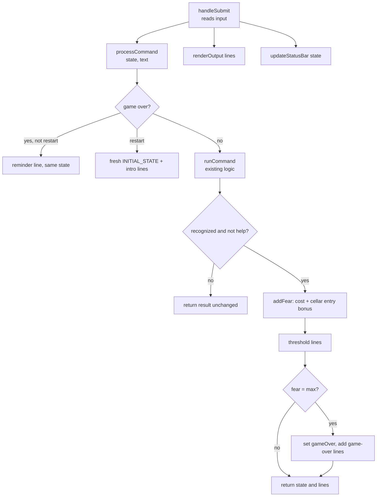

# Design Document: Fear Meter

## Overview

The fear meter adds a fear number to the game state. Fear rises with each recognized command, rises faster in the cellar, and jumps when the player enters the cellar. The status bar shows the room name and fear. Crossing 25, 50 and 75 shows a one-time line. At 100 the Caretaker catches the player, and only `restart` works.

The design follows the current code in `game.js`, `index.html` and `style.css`, including the developer's hand edits (synonyms, `examine`, `move rug`, `help`, the `>>` echo, the typed-text prompt). None of that code changes behavior. The fear logic is added around the existing command logic, not inside it.

Key decisions:

- **Wrap, don't edit.** The current `processCommand` is renamed `runCommand` and left as it is. A new `processCommand` calls it, then adds fear. This is what keeps Requirement 9 (existing behavior preserved) true by construction.
- **Pure functions.** All fear logic takes a state and returns a new state. It never touches the page, so `processCommand` stays free of DOM access (Requirement 9.6).
- **The game owns all facts.** Fear, thresholds shown and game over live in the game state. The narrator only prints text the code gives it.
- **One place for numbers.** Every fear number sits in a constants block at the top of `game.js`.

## Architecture



Only `handleSubmit` and `init` touch the page. They call `renderOutput` (already there) and a new `updateStatusBar`.

### Why wrap `runCommand`

| Option | Trade-off |
|---|---|
| Edit every handler to add fear | Many small edits in code the developer also edits by hand. Easy to miss one. |
| Wrap the existing logic (chosen) | One new function. Handlers stay as written. Fear rules live together and are easy to read. |

## Components and Interfaces

All changes are in `game.js`, except one small change in `index.html`.

### 1. Fear constants (top of `game.js`, before any function)

```js
// ---- Fear settings: change these numbers to tune the game ----
const FEAR_START = 0;            // fear at the start of a game
const FEAR_MAX = 100;            // the Caretaker catches you at this number
const FEAR_COST_NORMAL = 1;      // fear added by each command
const FEAR_COST_CELLAR = 3;      // fear added by each command used in the cellar
const FEAR_CELLAR_ENTRY = 10;    // extra fear for going down into the cellar
const FEAR_THRESHOLDS = [25, 50, 75];   // fear levels that show a warning line
// One line per threshold, in the same order as FEAR_THRESHOLDS.
const THRESHOLD_LINES = [
  "The air grows colder, and the house seems to lean closer.",
  "Somewhere above you, slow footsteps stop moving.",
  "You are sure now that something is standing right behind you."
];
const GAME_OVER_LINES = [
  "The Caretaker has found you. The lamp light shrinks, and the dark closes over you without a sound.",
  "Type restart to try again."
];
const GAME_OVER_REMINDER = "The Caretaker has you. Type restart to try again.";
```

The `FEAR_THRESHOLDS` and `THRESHOLD_LINES` arrays share an index. No other code writes a fear number as a literal (Requirement 2.3). Requirement 2.2 asks for named threshold values. The array holds all three under one name. If the developer wants three separate names, the array can be built from them without changing any other code.

### 2. State changes

`INITIAL_STATE` gets three new fields:

```js
fear: FEAR_START,        // whole number, 0 to FEAR_MAX
shownThresholds: [],     // thresholds already announced, such as [25, 50]
gameOver: false,         // true once the Caretaker has caught the player
```

Existing code never changes a state object in place. It builds a new one with `{ ...state }`. So `INITIAL_STATE` is never modified, and restart can return `INITIAL_STATE` itself. This restores the lamp and removes the trapdoor, because the changes made to the rooms were made on copies (Requirement 8.5).

### 3. Recognized commands

`handleUnknown` gets one extra field, `unknown: true`, in the result it returns. Its text and state are unchanged. The wrapper treats a command as recognized when the input is not empty, the result is not marked `unknown`, and the command is not `help` (cost-free) or `restart`.

`runCommand` returns the same `{ state, lines }` shape as before.

### 4. New functions

| Function | Purpose |
|---|---|
| `processCommand(state, rawInput)` | New top level. Handles game over, restart, then calls `runCommand` and applies fear. Pure. |
| `runCommand(state, rawInput)` | The old `processCommand`, renamed. Body unchanged apart from the restart check below. |
| `applyFear(oldState, result)` | Works out the fear cost and cellar entry bonus, clamps to `FEAR_MAX`, returns a new state. |
| `getThresholdLines(oldFear, newState)` | Returns `{ shownThresholds, lines }` for thresholds newly crossed, in ascending order. |
| `getStatusText(state)` | Returns `"<Room name> | Fear: <number>"`. Pure. |
| `updateStatusBar(state)` | Writes `getStatusText(state)` into `#status-bar`. The only new DOM function. |

### 5. Pseudocode for `processCommand`

```js
function processCommand(state, rawInput) {
  const command = normalizeCommand(rawInput);

  // Restart works any time, and costs no fear.
  if (command === "restart") {
    return { state: INITIAL_STATE, lines: [...INTRO, "\u00A0", ...handleLook(INITIAL_STATE).lines] };
  }

  // Empty input does nothing, even after game over.
  if (command === "") return { state, lines: [] };

  // After game over, nothing runs except restart.
  if (state.gameOver) return { state, lines: [GAME_OVER_REMINDER] };

  // Run the normal command logic first.
  const result = runCommand(state, rawInput);

  // Unknown text and help cost no fear.
  if (result.unknown || command === "help") return result;

  // Add fear, then threshold lines, then game over.
  const newState = applyFear(state, result.state);
  const thresholds = getThresholdLines(state.fear, newState);
  const lines = [...result.lines, ...thresholds.lines];
  // ... set shownThresholds; if fear is FEAR_MAX set gameOver and add GAME_OVER_LINES
  return { state: finalState, lines };
}
```

`applyFear` picks the cost from the room **before** the command (`state.currentRoomId === "cellar"` gives `FEAR_COST_CELLAR`). It adds `FEAR_CELLAR_ENTRY` when the room before was not the cellar and the room after is the cellar (an accepted move, Requirement 4). A refused move leaves the room unchanged, so no bonus is added (Requirement 4.2). A refused command still costs fear (Requirement 3.5), because `result.unknown` is false for it.

The wrapper checks `command === "restart"` before `runCommand`, so `restart` never reaches `runCommand` and never becomes "unknown". Restart lines reuse `INTRO` and `handleLook`, as `init` does now.

### 6. Page changes (`handleSubmit`, `init`, `index.html`)

- `handleSubmit`: after `gameState = result.state`, call `updateStatusBar(gameState)`. The rest (echo, blank lines, clearing, focus, scrolling) is untouched.
- `init`: after setting `gameState`, call `updateStatusBar(gameState)` so the bar shows `Hallway | Fear: 0`.
- `index.html`: the status bar text "HAUNTED ADVENTURE" stays as a first-paint placeholder and is replaced by `init`. The comment above it ("the room name later") already expects this.
- `style.css`: no change.

## Data Models

```js
// Game state (new fields marked)
{
  currentRoomId: "hallway",
  carriedItems: [],
  rooms: { ... },           // unchanged
  fear: 0,                  // NEW: whole number, 0..FEAR_MAX
  shownThresholds: [],      // NEW: subset of FEAR_THRESHOLDS already announced
  gameOver: false           // NEW: true when fear reaches FEAR_MAX
}

// Command result (unchanged shape, one optional flag)
{ state, lines, unknown? }  // unknown is true only from handleUnknown
```

Rules the state always follows:

1. `fear` is a whole number with `FEAR_START <= fear <= FEAR_MAX`.
2. `gameOver` is true exactly when `fear === FEAR_MAX`.
3. `shownThresholds` holds every threshold that is less than or equal to `fear`, each once.

Fear changes in `applyFear` only. Nothing the narrator prints can change it.

## Correctness Properties

*A property is a characteristic or behavior that should hold true across all valid executions of a system-essentially, a formal statement about what the system should do. Properties serve as the bridge between human-readable specifications and machine-verifiable correctness guarantees.*

Properties 1 to 6 and 8 run on `processCommand` with generated command sequences. Property 7 runs on `getStatusText`. Where a requirement needs a crafted state (for example the cellar without a lamp), the test builds that state directly.

### Property 1: Fear stays valid and matches game over

For any sequence of commands run from the initial state, after every command `fear` is a whole number from `FEAR_START` to `FEAR_MAX`, and `gameOver` is true exactly when `fear` equals `FEAR_MAX`.

**Validates: Requirements 1.1, 1.3, 1.4, 7.1**

### Property 2: Fear cost follows the room before the command

For any state that is not game over and any recognized command other than `help` and `restart`, the new fear equals `min(FEAR_MAX, oldFear + cost + bonus)`. The cost is `FEAR_COST_CELLAR` if the room before was the cellar, else `FEAR_COST_NORMAL`. The bonus is `FEAR_CELLAR_ENTRY` if the room before was not the cellar and the room after is the cellar, else 0. Refused commands cost the same and leave the room and items unchanged.

**Validates: Requirements 3.1, 3.2, 3.5, 3.6, 4.1, 4.2, 4.3**

### Property 3: Free commands leave fear unchanged

For any state that is not game over, and any input that is `help`, empty or only spaces, or text that is not a recognized command, the new fear equals the old fear, and no fear or threshold lines are added. The reply for unknown text is "That command is not recognized."

**Validates: Requirements 3.3, 3.4, 9.4**

### Property 4: Thresholds are shown once, in order

For any sequence of commands, each threshold line appears in the replies at most once. Every threshold at or below the current fear is in `shownThresholds`. When one command crosses several thresholds, their lines appear in ascending order, after the command's normal reply.

**Validates: Requirements 6.1, 6.2, 6.3, 6.4, 6.5, 6.6, 7.4**

### Property 5: Game over locks every command except restart

For any state with `gameOver` true and any non-empty input other than `restart`, the reply is exactly one reminder line and the returned state equals the given state.

**Validates: Requirements 7.5, 7.6**

### Property 6: Restart gives a fresh game

For any state, including game over states, `restart` returns a state equal to `INITIAL_STATE` (fear 0, starting room, no items carried, lamp in the hallway, no trapdoor, no thresholds shown, `gameOver` false). The next command runs normally.

**Validates: Requirements 8.1, 8.4, 8.5, 8.6, 8.7**

### Property 7: Status text shows room and fear

For any room id in the game and any fear from 0 to `FEAR_MAX`, `getStatusText` returns the room name, then ` | Fear: `, then the fear number.

**Validates: Requirements 5.1**

### Property 8: Existing behavior is preserved

For any state that is not game over and any command, the room, carried items, rooms and reply text from `processCommand` equal those from `runCommand`. Only the fear fields and the extra threshold or game-over lines differ.

**Validates: Requirements 9.1, 9.2**

## Error Handling

| Situation | Behavior |
|---|---|
| Unknown text, or `go` with a bad direction | Existing "not recognized" reply, no fear change. |
| Empty or whitespace input | No output, no fear change, even after game over. |
| Locked door, dark room, missing item | Existing refusal text. Fear still rises (Requirement 3.5). |
| Fear would pass the maximum | Clamped to `FEAR_MAX` by `Math.min`. |
| Several thresholds in one command | One line each, ascending. |
| Command after game over | One reminder line. State untouched. |
| `restart` at any time | Fresh state, intro, room description. |
| Status bar element missing | `updateStatusBar` does nothing if `#status-bar` is not found. |

## Testing Strategy

PBT applies to the fear logic because it is made of pure functions over a large input space (command sequences and states). It does not apply to the status bar update, the page wiring or the tone of the text. Those are checked by hand in the browser.

The project rules say not to install tools or run syntax checks, so no tests are run as part of this design. The developer tests in the browser. Automated tests are optional. If the developer wants them, they can go in a separate `tests.html` that loads `game.js` and the [fast-check](https://fast-check.dev/) library from a script tag, and prints pass or fail in the page. No Node.js is needed. The properties above are written so they can be added later without changing the game code.

**Property tests (optional, fast-check):**
- Use fast-check. Do not write a property tester from scratch.
- Run at least 100 iterations per property.
- One test per property. Tag each with `Feature: fear-meter, Property <number>: <title>`.
- Generators: a list of commands drawn from `look`, `go north`, `go south`, `go down`, `go up`, `take lamp`, `inventory`, `examine desk`, `move rug`, `help`, `restart`, plus random strings. Crafted states set `fear`, `shownThresholds` and `gameOver` directly.

**Example tests (optional):**
- Starting state has fear 0, `getStatusText` gives `Hallway | Fear: 0` (5.2).
- `go south` in the hallway (locked door) raises fear and keeps the room (3.5).
- With the trapdoor open and no lamp, `go down` is refused and adds no entry bonus (4.2).
- With the lamp, `go down`, `go up`, `go down` adds the entry bonus twice (4.3).
- From fear 99 with threshold 75 not yet shown, a command shows the normal reply, the 75 line, then the game-over lines in that order (7.2, 7.3, 7.4).
- `restart` shows the intro and hallway description (8.2).

**Manual browser checks:**
1. The status bar shows `Hallway | Fear: 0` on load and updates after each command and room change (5.3, 5.4).
2. Lower a constant, reload, and see the new value used (2.4).
3. Threshold lines and the game-over text read as short, cold and not gory (6.7, 7.2).
4. Typing, the `>>` echo, clearing, focus and scrolling still work (9.5).
5. Search `game.js` for fear numbers outside the constants block (2.1 to 2.3). Confirm `processCommand` has no `document` calls (9.6).

## Assumptions to confirm

- Empty input after game over prints nothing, rather than the reminder. The requirements speak of "a command", and empty input is not one.
- Threshold and game-over lines use the constants above as placeholder wording. The developer can change them in the constants block.
