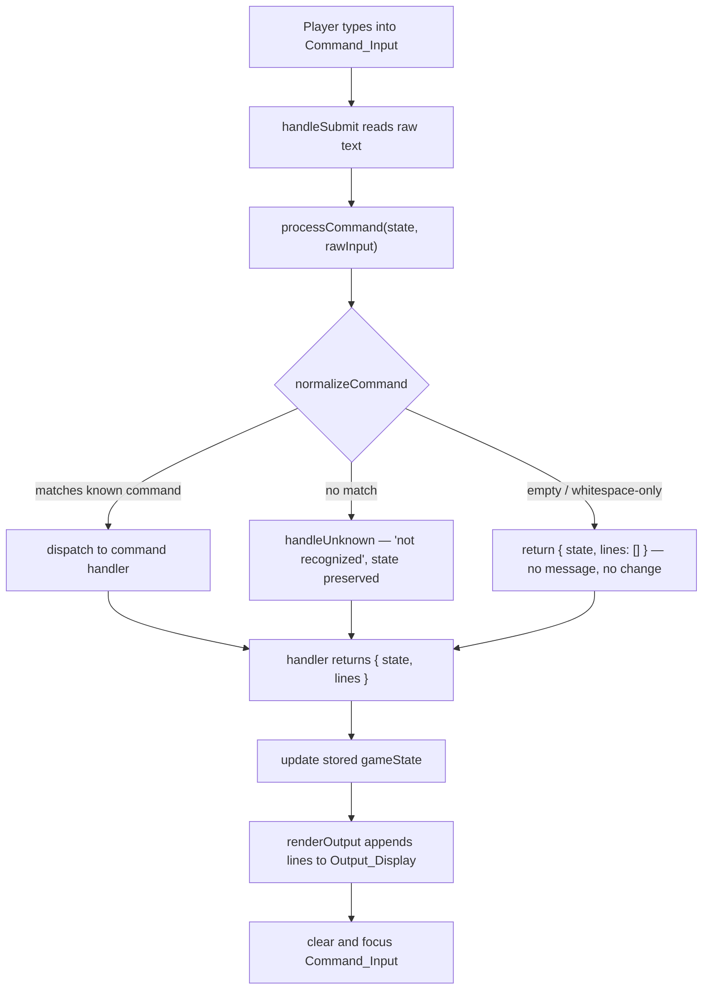
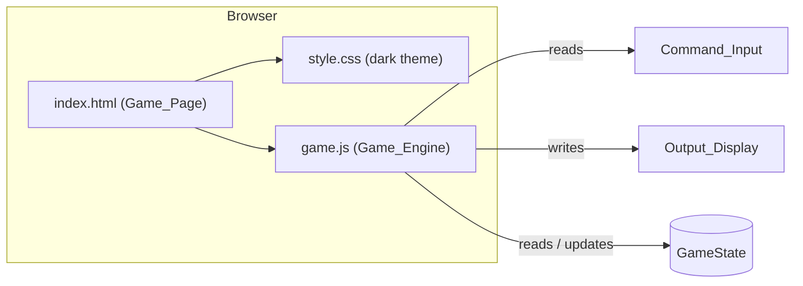

# Design Document: Haunted Text Adventure

## Introduction

This design describes the foundational version of Haunted Adventure: a haunted text adventure that runs as a single web page in the style of classic games like Zork. The player sees a dark screen describing one room — an old hallway in a haunted house — and types commands to interact with the game.

This first scope is intentionally minimal. It **excludes** the AI narrator and the fear meter, which may arrive in later features. It delivers only: a single room (the Hallway), four commands (`look`, `go north`, `take lamp`, `inventory`), and game code that tracks the current room and the items the player carries. The plain HTML/CSS/JavaScript game code is the single source of truth for all game facts; nothing external decides what is true.

## Overview

The game is a single-page web application with no build step, no frameworks, and no external resources. It runs by opening `index.html` in a browser. Three files make up the whole product:

- `index.html` — the Game_Page structure: an Output_Display area and a Command_Input field.
- `style.css` — the dark, haunted presentation.
- `game.js` — the Game_Engine: game state, command parsing, command handling, and DOM wiring.

The design separates **logic** (parsing and state transitions) from **presentation** (HTML/CSS and DOM rendering). The core logic lives in small, plain functions that take a state and return a new state plus output lines. Because these functions do not touch the DOM, they can be tested directly and exhaustively, including with property-based testing. The DOM layer only reads input, calls the logic, updates state, and renders text — it never decides what is true in the game.

### Scope and Exclusions

In scope:
- One room (the Hallway) and one item (the Lamp).
- Commands: `look`, `go north`, `take lamp`, `inventory`.
- Game state for current room and carried items.
- Dark screen presentation.

Out of scope (future features):
- The AI narrator.
- The fear meter.
- Additional rooms, movement that succeeds, or more items.

### Research Summary

Two areas informed this design:

1. **Property-based testing for JavaScript.** [fast-check](https://github.com/dubzzz/fast-check) is the standard QuickCheck-style library for JavaScript/TypeScript. It generates hundreds of random inputs per property, finds edge cases, and shrinks failing cases to minimal examples. The game engine's command parsing and state transitions are pure functions, which is exactly where property-based testing adds the most value. fast-check will be used for the engine logic; the game code itself stays framework-free.

2. **Text adventure architecture.** Browser-based text adventure engines (for example, [text-engine](https://github.com/okaybenji/text-engine)) commonly follow a read → parse → execute → display loop, with a command parser that normalizes input (trim and case-fold) and dispatches to handlers, and a central module managing rooms and player state. This design follows that well-established pattern, scaled down to one room and one item and kept simple enough for a beginner.

## Architecture

The Game_Engine runs a command loop. Each time the player submits a command:

1. The DOM layer reads the text from the Command_Input.
2. The text is passed to the pure `processCommand(state, rawInput)` function.
3. `processCommand` normalizes the input (trim, lowercase), matches it to a known command, and calls the matching handler.
4. The handler returns a new state and a list of output lines.
5. The DOM layer updates the stored game state and appends the lines to the Output_Display.
6. The Command_Input is cleared and refocused for the next entry.

The only facts the engine ever changes are the current room and the carried items (and, as a consequence, the items present in a room when the lamp is taken). Every output line the player sees is produced by the game code from these facts — never invented.



### Components Overview



### Key Design Decisions

| Decision | Rationale |
| --- | --- |
| Pure `processCommand(state, rawInput)` separate from the DOM | Logic with no DOM side effects is easy to test, including property-based tests. It also keeps the game code as the single source of truth — the DOM never decides facts. |
| A single `state` object holds everything that can change | One plain object gives a beginner a clear mental model: "the state is the whole game right now." Predictable transitions make invariants easy to verify. |
| Handlers return a new state rather than mutating in place | Returning new state makes transitions predictable and testable; the spread operator used is beginner-accessible and keeps each handler small. |
| Commands matched after `trim()` + `toLowerCase()` | Satisfies the case- and whitespace-insensitive recognition rule. |
| `maxlength="100"` on the input plus trimming in logic | Satisfies the 100-character limit; logic still trims, so leading/trailing spaces never break matching. |
| `game.js` exposes pure functions for Node when available, and wires the DOM only when `document` exists | Lets the same file run in the browser with no build step while remaining testable in Node. No frameworks required. |

## Components and Interfaces

### Game_Page — `index.html`

Structure only; presentation lives in CSS, behavior in JS.

| Element | Role | Notes |
| --- | --- | --- |
| `#output` (Output_Display) | Shows room descriptions and text replies | A scrollable area; lines are appended as new elements. |
| `#command-input` (Command_Input) | Text field for player commands | `type="text"`, `maxlength="100"`, `autofocus`. |
| `<form>` | Wraps the input so Enter submits | `submit` event drives the command loop. |

The page links `style.css` and `game.js` with relative paths only — no external URLs.

### Presentation — `style.css`

- `body` / `html`: dark background covering the full viewport (`min-height: 100vh`), dark background color.
- Text: a light color with readable contrast against the dark background.
- `#output`: monospace font, text aligned left, grows with content, scrolls when it overflows.
- `#command-input`: light text on dark field, visible caret, full width.
- No external fonts, images, or resources.

### Game_Engine — `game.js`

The engine is organized into three layers: **data**, **logic**, and **DOM wiring**.

#### Data

- `INITIAL_STATE` — the starting game state (see Data Models).
- `ROOMS` is not separate; rooms live inside `state.rooms` because an item being taken changes a room's contents, and keeping all changeable facts in one state object keeps transitions pure and simple.

#### Logic (pure functions — no DOM access)

```js
// Normalize raw input: trim whitespace and lowercase.
// Returns "" for empty/whitespace-only input, otherwise the normalized command.
function normalizeCommand(rawInput) -> string

// The core transition. Pure: does not read or write the DOM.
// Returns { state: newState, lines: string[] }.
//   - lines is [] when there is nothing to display (empty input).
//   - newState === state (same reference) when state must not change,
//     so callers/tests can detect "no change" cheaply.
function processCommand(state, rawInput) -> { state, lines }

// Command handlers. Each returns { state, lines }.
function handleLook(state)      -> { state, lines }   // Req 4
function handleGoNorth(state)   -> { state, lines }  // Req 5
function handleTakeLamp(state)  -> { state, lines }  // Req 6
function handleInventory(state) -> { state, lines } // Req 7
function handleUnknown(state)   -> { state, lines }  // Req 8
```

Dispatch rules in `processCommand`:

| Normalized input | Handler | State change |
| --- | --- | --- |
| `""` (empty / whitespace-only) | (none) | none; `lines = []` (input cleared by DOM, no message) |
| `look` | `handleLook` | none |
| `go north` | `handleGoNorth` | none (cannot move) |
| `take lamp` | `handleTakeLamp` | moves lamp from room to carried items, or none if already carried |
| `inventory` | `handleInventory` | none |
| anything else | `handleUnknown` | none; message "not recognized" |

#### DOM Wiring (runs only when `document` exists)

```js
function renderOutput(lines)        // append each line to #output
function handleSubmit(event)        // prevent default, read input, call processCommand,
                                    // update gameState, renderOutput, clear + focus input
function init()                     // set gameState = INITIAL_STATE, display the
                                    // Hallway description (Req 2.4), wire events, focus input
```

`init()` runs on `DOMContentLoaded`. It sets the initial state (Hallway as current room, Lamp in the Hallway, carried items empty) and immediately displays the Hallway description so the player can begin.

#### Module exposure for testing

To allow the same file to be required by Node tests without a build step:

```js
// Expose pure logic for Node-based tests; harmless in the browser.
if (typeof module !== "undefined" && module.exports) {
  module.exports = {
    normalizeCommand, processCommand,
    handleLook, handleGoNorth, handleTakeLamp, handleInventory, handleUnknown,
    INITIAL_STATE
  };
}
```

The DOM wiring guards itself with a `document` check so requiring the file in Node has no side effects.

## Data Models

All changeable game facts live in a single plain `state` object. Static descriptions are part of the room data inside state; the only thing that changes about a room is the list of items present in it.

### Game State

```js
state = {
  currentRoomId: string,   // id of the room the player occupies; exactly one at a time
  carriedItems: string[],  // names of items the player carries, e.g. ["lamp"]
  rooms: {                 // roomId -> Room
    hallway: Room
  }
}
```

### Room

```js
Room = {
  name: string,        // display name, e.g. "Hallway"
  description: string, // shown on look and at start
  items: string[]      // names of items present in the room, e.g. ["lamp"]
}
```

### Initial State (`INITIAL_STATE`)

```js
{
  currentRoomId: "hallway",
  carriedItems: [],
  rooms: {
    hallway: {
      name: "Hallway",
      description: "You stand in an old hallway of a haunted house. Dust coats the floorboards and cobwebs drape the walls. A single lamp sits on the floor.",
      items: ["lamp"]
    }
  }
}
```

### Command Representation

A command is the normalized input string: `rawInput.trim().toLowerCase()`. Known commands are the exact strings `"look"`, `"go north"`, `"take lamp"`, and `"inventory"`. Item names are plain lowercase strings (currently just `"lamp"`); a small item-name dictionary can be added in a future feature if items need richer display text.

### Requirements Coverage

| Requirement | Where addressed |
| --- | --- |
| 1. Dark screen display | `style.css` dark background + light text |
| 2. Initial game state | `init()` + `INITIAL_STATE` |
| 3. Command input | `index.html` (`maxlength="100"`, form submit) + `normalizeCommand` |
| 4. Look | `handleLook` |
| 5. Go north | `handleGoNorth` |
| 6. Take lamp | `handleTakeLamp` |
| 7. Inventory | `handleInventory` |
| 8. Unknown command | `handleUnknown` |
| 9. Game state tracking | `state` object + pure `processCommand` transitions |
| 10. Technology constraint | plain HTML/CSS/JS, relative paths only, no external URLs |


## Correctness Properties

*A property is a characteristic or behavior that should hold true across all valid executions of a system — essentially, a formal statement about what the system should do. Properties serve as the bridge between human-readable specifications and machine-verifiable correctness guarantees.*

The properties below target the **pure Game_Engine logic** (`normalizeCommand`, `processCommand`, and the command handlers). They do not cover CSS presentation or DOM side effects (clearing the input, appending to the page), which are validated by example tests described in the Testing Strategy. The remaining, non-logic acceptance criteria (dark screen, initial setup values, file/technology constraints) are covered by example and smoke tests rather than properties.

### Property 1: Command normalization is idempotent and recognizes known commands case- and whitespace-insensitively

For any string `s`, `normalizeCommand(normalizeCommand(s)) === normalizeCommand(s)`. For any known command `k` in `{"look", "go north", "take lamp", "inventory"}`, and any string formed by wrapping `k` in arbitrary leading/trailing whitespace and changing its letter case arbitrarily, `normalizeCommand` yields `k`.

**Validates: Requirements 3.3**

### Property 2: Whitespace-only input produces no output and no state change

For any input string composed only of whitespace characters, `processCommand(state, input)` returns `lines` equal to an empty array and leaves the state unchanged (`currentRoomId` and `carriedItems` identical to the input state).

**Validates: Requirements 3.4**

### Property 3: Unknown commands report "not recognized" and preserve state

For any state and any non-empty input that does not normalize to one of `look`, `go north`, `take lamp`, or `inventory`, `processCommand` returns a line stating the command is not recognized, and leaves `currentRoomId` and `carriedItems` unchanged from the input state.

**Validates: Requirements 8.1, 8.2, 9.4**

### Property 4: Look shows the current room's description and every item present

For any state, `handleLook(state)` returns output that includes the description of the room identified by `state.currentRoomId` and mentions every item present in that room's `items` list.

**Validates: Requirements 4.1**

### Property 5: Go north reports it cannot move and leaves the room unchanged

For any state, `handleGoNorth(state)` returns a line indicating the player cannot move north, and returns a state whose `currentRoomId` equals the input state's `currentRoomId`.

**Validates: Requirements 5.1, 5.2**

### Property 6: Take lamp transfers the lamp when present, otherwise is a no-op with a message

For any state, `handleTakeLamp(state)` behaves as follows: if the lamp is present in the current room's `items`, the returned state has the lamp removed from that room's `items` and added to `carriedItems`, and the output mentions taking the lamp; if the lamp is already in `carriedItems`, the returned state is unchanged and the output mentions already carrying the lamp.

**Validates: Requirements 6.1, 6.2, 9.3**

### Property 7: Inventory lists every carried item, or reports carrying nothing

For any state, `handleInventory(state)` behaves as follows: if `carriedItems` is non-empty, the output names every item in `carriedItems`; if `carriedItems` is empty, the output states the player carries nothing.

**Validates: Requirements 7.1, 7.2, 9.3**

### Property 8: State-shape invariant after any command

For any state and any input string, after `processCommand(state, input)` the resulting `currentRoomId` is a single string that is a key of the resulting `state.rooms`, and the resulting `carriedItems` is an array.

**Validates: Requirements 9.1, 9.2**

## Error Handling

The engine is designed never to throw on player input. `processCommand` always returns `{ state, lines }` for any string, including malformed, oversized-after-trim, or unexpected input. Specific handling:

| Situation | Handling | Requirement |
| --- | --- | --- |
| Empty or whitespace-only input | Return `{ state, lines: [] }`; DOM clears the input and displays nothing. State unchanged. | 3.4 |
| Known command (any case, surrounding whitespace) | Normalize, dispatch to its handler. | 3.3 |
| Unknown command (non-empty, no match) | Return a "not recognized" line; state unchanged. | 8.1, 8.2, 9.4 |
| `go north` | Return a "cannot move north" line; `currentRoomId` unchanged. | 5.1, 5.2 |
| `take lamp` when lamp is in the room | Remove lamp from the room, add to `carriedItems`, return a "taken" line. | 6.1 |
| `take lamp` when lamp is already carried | Return an "already carries the lamp" line; state unchanged. | 6.2 |
| `inventory` with items | Return a line per item name (or a single listing line naming each). | 7.1 |
| `inventory` with no items | Return a "carries nothing" line. | 7.2 |
| Input longer than 100 characters | Prevented at the input by `maxlength="100"`; logic still trims and processes safely. | 3.1 |

No `try/catch` is required around normal command flow. Defensive checks (e.g., the current room always exists in `state.rooms`) are guaranteed by the state-shape invariant (Property 8) and are not expected to fail during play.

## Testing Strategy

### Dual testing approach

- **Unit / example tests** cover specific behaviors, DOM wiring, presentation, and the technology constraint.
- **Property-based tests** cover the universal logic properties of the Game_Engine across generated inputs.

Both are complementary: unit tests catch concrete regressions in specific scenarios and the DOM; property tests verify general correctness of the pure logic across wide input spaces.

### Property-based tests (logic)

Use [fast-check](https://github.com/dubzzz/fast-check) for JavaScript property-based testing. The pure logic is exposed via `module.exports` (see Components and Interfaces), so tests `require` `game.js` in Node and run without a DOM.

- Each property test MUST run a minimum of **100 iterations** (`{ numRuns: 100 }` in `fc.assert`).
- Each property test MUST be tagged with a comment referencing the design property, using the format: `Feature: haunted-text-adventure, Property {number}: {property_text}`.
- Implement exactly one property-based test per correctness property (Properties 1–8 above).
- Generators to use:
  - Arbitrary whitespace-only strings (Property 2).
  - Arbitrary strings with random case and random surrounding whitespace, including the four known commands (Property 1).
  - Arbitrary non-empty strings that are not known commands (Property 3).
  - Random valid states with varied `carriedItems` and varied room `items`, plus the current room always set to a valid room id (Properties 4, 6, 7, 8).
  - Random inputs combined with random states (Properties 3, 8).

### Unit / example tests (specific behavior and DOM)

- `INITIAL_STATE` values: `currentRoomId === "hallway"`, Hallway `items` contains `"lamp"`, `carriedItems` is empty (Requirements 2.1–2.3).
- `handleLook` on the initial state shows the Hallway description and the lamp (Requirement 4.1 example).
- `handleGoNorth` returns a cannot-move message (Requirement 5.1 example).
- `handleTakeLamp` on the initial state moves the lamp to `carriedItems` (Requirement 6.1 example); a second `take lamp` returns an already-carries message and leaves state unchanged (Requirement 6.2 example).
- `handleInventory` empty returns "carries nothing"; after taking the lamp it lists the lamp (Requirements 7.1, 7.2 examples).
- `handleUnknown` returns a not-recognized message (Requirement 8.1 example).
- DOM wiring: submitting a valid command clears the input (Requirement 3.2); `init()` renders the Hallway description to `#output` (Requirement 2.4).
- Presentation: the body background is dark and covers the viewport; text color is light against it (Requirements 1.1, 1.2).
- `#command-input` has `maxlength="100"` (Requirement 3.1).
- The HTML and CSS contain no external URL references (Requirement 10.2), and no frameworks are used (Requirement 10.1).

DOM and presentation tests require a DOM environment (e.g., jsdom) or a browser test runner; the pure-logic property and unit tests run in plain Node.

### What is not property-tested and why

CSS presentation (Requirements 1.1, 1.2), fixed initial values (2.1–2.3), startup rendering (2.4), the `maxlength` attribute (3.1), the input-clearing DOM side effect (3.2), and the technology constraint (10.1, 10.2) do not vary meaningfully with input and are therefore covered by example or smoke tests, not property-based tests.
