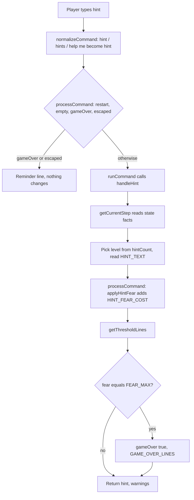

# Design Document

## Overview

This design adds a `hint` command to the Haunted Adventure. The player types "hint", "hints" or "help me". The game finds the first escape step the player has not done yet, and shows one short hint line for it. Repeating the command on the same step gives a clearer line, up to three levels. Each hint adds a fixed 5 fear.

All changes are in `game.js`. `index.html` and `style.css` stay as they are, because the hint reply uses the existing `renderOutput` and the existing status bar.

Design decisions:

- **The game code decides everything.** The current step comes only from facts in the game state. The hint text comes from a fixed table in code. The narrator never chooses a hint.
- **Hints never lie.** The hint line is returned as written and never passes through `applyLies`.
- **Reuse the existing fear flow.** A hint travels through the same threshold and game-over steps in `processCommand` as any other command. Only the fear cost differs.
- **Record facts as they happen.** The game does not yet remember some things it needs (Library entered, desk examined, and so on). Small boolean flags are added to the state and set by the existing handlers.
- **Existing code is kept.** The developer edits the files by hand, so each change below is small and local.

No tests are planned for this feature, so this document has no Correctness Properties or Testing Strategy sections.

## Architecture

The hint command follows the path every command already takes. Two places change: `normalizeCommand` (new synonyms) and `processCommand` (hint fear cost).



Order of output lines for a hint: the hint line, then any threshold lines, then the game-over lines if fear reached the maximum.

## Components and Interfaces

### New constants (top of game.js, near the other fear constants)

```javascript
// Fear added when the player asks for a hint.
const HINT_FEAR_COST = 5;
```

### HINT_TEXT table (after ITEM_DETAILS)

An array with one entry per escape step (step 1 is index 0). Each entry holds three lines: level 1 (vague), level 2, level 3 (names the object or place). No line contains the exact command to type.

```javascript
// HINT_TEXT holds the hints. HINT_TEXT[step - 1][level - 1] is one line.
// Level 1 is vague. Level 3 points at the object or place.
const HINT_TEXT = [
  // Step 1: take the lamp
  [
    "The dark will not forgive you for walking into it empty-handed.",
    "Something brass lies near your feet, made to carry a flame.",
    "The old oil lamp in this hallway. Pick it up before you go further."
  ],
  // Step 2: go north to the Library
  [
    "The cold draught has a direction. Follow the smell of paper.",
    "The dark archway breathes from deeper in the house.",
    "The archway leads north, into the Library."
  ],
  // Step 3: examine the desk and read the torn page
  [
    "Someone left words behind. Words are worth reading.",
    "Look closely at what stands in the middle of the Library.",
    "The reading desk holds a torn page. Study the desk, then the page."
  ],
  // Step 4: pull the rug aside
  [
    "The floor remembers where something heavy has been moved.",
    "One edge of the floor covering curls away from the boards.",
    "The moth-eaten rug in the Library hides something. Drag it aside."
  ],
  // Step 5: go down to the Cellar
  [
    "The cold that rises here comes from below.",
    "Something gapes in the floor now, and the air through it smells of earth.",
    "The trapdoor in the Library leads down to the Cellar. Bring your light."
  ],
  // Step 6: examine the wall
  [
    "Something in this room has been said many times.",
    "The walls here are not as blank as they first seem.",
    "Scratched words cover the Cellar wall. Study them closely."
  ],
  // Step 7: pull the crooked stone
  [
    "One thing here sits out of line with the rest.",
    "Worn edges show that hands have gripped it before.",
    "The crooked stone in the Cellar wall will move if you pull it."
  ],
  // Step 8: take the key
  [
    "What the house hid is waiting where the stone used to be.",
    "Something cold and made of iron lies in the hollow.",
    "The old iron key is in the hollow in the Cellar wall. Pick it up."
  ],
  // Step 9: go back up to the Hallway and unlock the front door
  [
    "You have what you came for. Now return to where you started.",
    "The way out has not moved, and neither has its lock.",
    "Climb back up to the Hallway. The key was made for the front door."
  ]
];
```

### normalizeCommand (small change)

Add two entries to the existing `synonyms` list. "help" is not touched, so it still shows the help text.

```javascript
"hint": "hint", "hints": "hint", "help me": "hint",
```

Every later check uses the standard word `"hint"`.

### Recording facts (small changes to existing handlers)

| Fact flag | Set by | Change |
|---|---|---|
| `libraryEntered` | `handleGo` | When `nextRoomId === "library"`, the new state sets `libraryEntered: true`. |
| `cellarEntered` | `handleGo` | When `nextRoomId === "cellar"`, the new state sets `cellarEntered: true`. |
| `deskExamined` | `handleExamine` | When the player examines the desk in the Library, return a new state with the flag set. |
| `pageExamined` | `handleExamine` | When the player examines the page in the Library, return a new state with the flag set. |
| `wallExamined` | `handleExamine` | When the player examines the wall in the Cellar, return a new state with the flag set. |

In `handleExamine`, the branch that returns `room.details[thing]` gets a small addition. The aliases already map "diary", "note" and "paper" to `page`, so the existing `thing` value works as the key:

```javascript
// Something fixed in the room (desk, rug, page...).
if (room.details && room.details[thing]) {
  // Remember the facts the hint command needs.
  let newState = state;
  if (state.currentRoomId === "library" && thing === "desk") newState = { ...state, deskExamined: true };
  if (state.currentRoomId === "library" && thing === "page") newState = { ...state, pageExamined: true };
  if (state.currentRoomId === "cellar" && thing === "wall") newState = { ...state, wallExamined: true };
  return { state: newState, lines: [room.details[thing]] };
}
```

The reply text stays the same as before. Only the returned state can differ.

### Step helpers (new, placed before `runCommand`)

```javascript
// isStepDone says if an escape step (1 to 9) is done, using only the state.
function isStepDone(state, step) {
  const library = state.rooms.library;
  const cellar = state.rooms.cellar;
  switch (step) {
    case 1: return state.carriedItems.includes("lamp");
    case 2: return state.libraryEntered;
    case 3: return state.deskExamined && state.pageExamined;
    case 4: return Boolean(library.exits.down);
    case 5: return state.cellarEntered;
    case 6: return state.wallExamined;
    case 7: return Boolean(cellar.stoneMoved);
    case 8: return state.carriedItems.includes("key");
    default: return false;
  }
}

// getCurrentStep returns the first step that is not done.
// If steps 1 to 8 are all done, it returns 9.
function getCurrentStep(state) {
  for (let step = 1; step <= 8; step++) {
    if (!isStepDone(state, step)) return step;
  }
  return 9;
}
```

### handleHint (new)

```javascript
// handleHint shows one hint for the current step. The hint gets clearer
// each time the player asks on the same step (3 levels at most).
// It only changes hintStep and hintCount. The text is never passed
// through applyLies, so a hint never lies.
function handleHint(state) {
  const step = getCurrentStep(state);

  // A new step starts again at level 1.
  const count = step === state.hintStep ? state.hintCount : 0;
  const level = Math.min(count, 2) + 1;

  const newState = { ...state, hintStep: step, hintCount: Math.min(3, count + 1) };
  // hint: true tells processCommand to charge HINT_FEAR_COST.
  return { state: newState, lines: [HINT_TEXT[step - 1][level - 1]], hint: true };
}
```

`runCommand` calls it right after the `help` check:

```javascript
// hint: show one hint for the current step.
if (command === "hint") {
  return handleHint(state);
}
```

### handleHelp (small change)

Add one line to the help text so the player can find the command:

```javascript
"Stuck? Type hint."
```

`help` is already skipped by the fear code (Step 5 of `processCommand`), so it costs no fear and does not change `hintCount`.

### applyHintFear (new) and processCommand (small change)

```javascript
// applyHintFear adds the fixed hint cost. It replaces the normal cost
// (and the cellar cost), and fear never goes above FEAR_MAX.
function applyHintFear(oldState, newState) {
  const fear = Math.min(FEAR_MAX, oldState.fear + HINT_FEAR_COST);
  return { ...newState, fear };
}
```

In `processCommand`, Step 6 picks the cost:

```javascript
// Step 6: add the fear cost. A hint has its own fixed cost.
const feared = result.hint ? applyHintFear(state, result.state) : applyFear(state, result.state);
```

Steps 7 to 9 (threshold lines, game over) are unchanged and run for hints too. The status bar is refreshed by `handleSubmit` after every command, so the new fear shows at once.

The game-over and escaped reminders (Requirement 7.1, 7.2) already happen in Steps 3 and 3b, before `runCommand`, so a hint after an ending changes nothing. "restart" returns `INITIAL_STATE`, which holds the starting hint facts (Requirement 7.3).

## Data Models

### New fields in INITIAL_STATE

```javascript
// ---- Hint facts (only game code changes these) ----
// True once the player has entered the Library.
libraryEntered: false,
// True once the player has entered the Cellar.
cellarEntered: false,
// True once the player has examined the desk, the page, and the wall.
deskExamined: false,
pageExamined: false,
wallExamined: false,
// The escape step the hint count belongs to (0 means no hint yet).
hintStep: 0,
// How many hints were shown for hintStep, from 0 to 3.
hintCount: 0,
```

### Escape steps and the facts that mark them done

| Step | Done when | Source |
|---|---|---|
| 1 Take the lamp | lamp carried | `carriedItems` |
| 2 Go north to the Library | `libraryEntered` | `libraryEntered` |
| 3 Examine desk and read page | `deskExamined` and `pageExamined` | new flags |
| 4 Pull the rug aside | Library has a `down` exit | `rooms.library.exits.down` |
| 5 Go down to the Cellar | `cellarEntered` | new flag |
| 6 Examine the wall | `wallExamined` | new flag |
| 7 Pull the crooked stone | `rooms.cellar.stoneMoved` | existing flag |
| 8 Take the key | key carried | `carriedItems` |
| 9 Go up and unlock the door | steps 1 to 8 done | derived |

### How the hint count resets

The count belongs to one step. `hintStep` remembers which step. When `handleHint` finds a different current step, it starts from 0, so Requirements 3.5 and 3.6 hold without any extra reset code in other handlers.

| hintCount for the step (before) | Level shown | hintCount (after) |
|---|---|---|
| 0 | 1 | 1 |
| 1 | 2 | 2 |
| 2 or more | 3 | 3 |

## Error Handling

- **Hint after game over or escape:** `processCommand` answers with `GAME_OVER_REMINDER` or `ESCAPE_REMINDER`. Fear and `hintCount` do not change.
- **Out-of-order play:** The step is picked by the first step not done, so a player who skips ahead (for example, enters the Cellar before reading the page) still gets a sensible hint. Done-checks are based on facts, not on order.
- **Walking north without the lamp:** Step 1 is done only when the lamp is carried. A player who enters the Library without the lamp still gets the step 1 hint, because the lamp is the first step not done.
- **Fear reaches the maximum:** `applyHintFear` caps fear at `FEAR_MAX`. The existing Step 9 then sets `gameOver` and appends `GAME_OVER_LINES` after the hint.
- **"help" is not "hint":** "help" stays in the help handler and costs nothing.
- **Missing text:** `HINT_TEXT` has fixed entries for steps 1 to 9. `getCurrentStep` never returns a number outside 1 to 9, so the lookup cannot miss.

## Requirements Coverage

| Requirement | Where it is met |
|---|---|
| 1 Hint command input | `synonyms` in `normalizeCommand`, `handleHint` returns one line |
| 2 Hint matches progress | New fact flags, `isStepDone`, `getCurrentStep` |
| 3 Hints get clearer | `hintStep`, `hintCount`, level table in `handleHint` |
| 4 Atmospheric text | `HINT_TEXT` table |
| 5 Fear cost | `HINT_FEAR_COST`, `applyHintFear`, existing Steps 7 to 9 |
| 6 Truthful hints | `handleHint` never calls `applyLies`; it changes only `hintStep`, `hintCount`, and fear |
| 7 Endings | Existing Steps 3 and 3b, `restart` returns `INITIAL_STATE` |
| 8 Help text | One added line in `handleHelp` |
| 9 Existing behavior | Existing handlers keep their replies. Only the returned state gains flags. |
