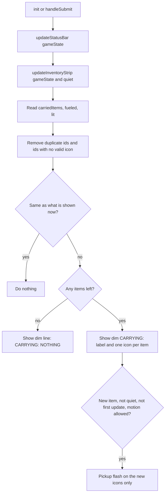

# Design Document

## Overview

The inventory strip is a bar under the status bar. It shows only what the player carries: a dim "CARRYING:" label followed by one 12 by 12 pixel-art icon for each carried item, in the order of `carriedItems`. When nothing is carried it shows one dim line, "CARRYING: NOTHING". There are no fixed slots, no empty outlines, no placeholders, and no names or tooltips for items the player does not carry, so the strip never reveals what exists in the game.

The strip only reads `carriedItems`, `fueled` and `lit` from `gameState`. It never writes to the state, so it cannot change any game rule, fear value, hint or lie.

The design has four parts:

1. **HTML.** A new `#header` element wraps `#status-bar` and a new empty `#inventory-strip` element.
2. **CSS.** The pinned-header rules move from `#status-bar` to `#header`. The strip has a fixed height. It is hidden while the body has the class `starting`, using CSS only.
3. **Data in game.js.** Two constants, an item name list, the icon grids with their palettes, and the three lamp looks.
4. **Functions in game.js.** An icon renderer that turns a grid into inline SVG, a lamp look picker, and an update function that redraws the strip from the state.

`updateInventoryStrip(gameState, quiet)` is called right next to each of the two existing `updateStatusBar(gameState)` calls, in `init` and in `handleSubmit`. `handleSubmit` also handles `restart`, so a restart refreshes the strip with no extra code. `quiet` is `true` only for a restart and tells the strip not to flash.

### Design decisions

| Decision | Reason |
|---|---|
| Wrap status bar and strip in one `#header` that is sticky | One element is pinned, so the strip can never drift away from the status bar (Req 1.1 to 1.3). |
| Draw only carried items, in `carriedItems` order | The strip can never hint at items the player has not found (Req 2.1, 2.2). |
| Fixed strip height set from the icon size constant plus padding | The header never changes height, so the output area does not jump when the first item is picked up (Req 1.5, 9.7). |
| Hide with `body.starting #inventory-strip { display: none; }` | The first rendered frame already has `class="starting"` in the HTML, so no script is needed and nothing flashes (Req 8.1 to 8.4). |
| Redraw the strip only when what it shows has changed | A running flame flicker or flash is not restarted by commands that change nothing. The check uses a short text signature. |
| `title` and `aria-label` are set only on carried icons | Uncarried items have no element, so nothing can leak (Req 7.1 to 7.3). |
| Call the update function right next to `updateStatusBar`, not inside it | The two call sites are easy to see, and `updateStatusBar` keeps doing one job (Req 5.3). |
| Wrap the update in `try/catch` | A strip failure must never stop commands or change the state (Req 10.3). |
| Icons are arrays of 12 strings plus a palette | Plain data a beginner can edit. No image files (Req 3.1, 3.3). |
| Flame flicker and pickup flash use CSS animations | No timers are needed to animate. Only one `setTimeout` removes the flash class. |

## Architecture



Page structure after the change:

```
body
  #header              (sticky, pinned, flex: 0 0 auto)
    #status-bar        (unchanged look, normal block)
    #inventory-strip   (new, normal block, fixed height)
  #output-wrap
    #loading-screen
    #output
  script game.js
```

### Files that change

| File | Change |
|---|---|
| `index.html` | Wrap `#status-bar` and the new `#inventory-strip` in `#header`. |
| `style.css` | Move the pinned-header rules to `#header`. Add strip, icon, flash and flicker rules. |
| `game.js` | Add two constants at the top. Add the item names, icon data and three functions. Add one call line after each `updateStatusBar(gameState)`, and one small `quiet` check in `handleSubmit`. |

No other game.js function is edited. `processCommand`, `runCommand`, fear, hints, lies and the typewriter code stay as they are.

## Components and Interfaces

### 1. index.html

Replace the current status bar block with a wrapper. The inner status bar markup stays exactly as it is.

```html
<!-- Header: pinned at the top. Holds the status bar and the inventory strip -->
<div id="header">

  <!-- Status bar: the game title for now, the room name later -->
  <div id="status-bar">
    <span>HAUNTED ADVENTURE</span>
    <span id="status-info"></span>
    <button type="button" id="sound-toggle">SOUND: ON</button>
  </div>

  <!-- Inventory strip: shows the items you carry. game.js fills it in -->
  <div id="inventory-strip" role="group" aria-label="Inventory"></div>

</div>
```

The body keeps `class="starting"`. That class is what hides the strip.

### 2. style.css

**Pinned header.** The pinned rules at the bottom of the file that now sit on `#status-bar` move to `#header`:

```css
/* The header keeps its size and stays pinned at the top. */
#header {
  flex: 0 0 auto;
  position: sticky;
  top: 0;
  z-index: 20;
}
```

The `#status-bar` block near the top (colors, font, padding, flex layout) stays as it is. Only `flex: 0 0 auto`, `position: sticky`, `top: 0` and `z-index: 20` are removed from it. `#status-bar` and `#inventory-strip` are then normal blocks inside `#header`, stacked one under the other. The status bar keeps its `flex-wrap` rule at 600px and below.

**Strip.** Same background, text color and font as the terminal area. The terminal area uses the body background `#0a0a0a` and green `#33ff66`, so the strip uses those values too. The height does not depend on how many icons are shown.

```css
/* Inventory strip: one row with a label and the carried icons. */
#inventory-strip {
  display: flex;
  align-items: center;
  gap: 6px;
  box-sizing: border-box;
  /* Fixed height: icon size + 12px padding + 1px border. Same for 0 to 6 icons. */
  height: calc(var(--icon-size, 32px) + 13px);
  padding: 6px 8px;
  background-color: #0a0a0a;
  color: #33ff66;
  font-family: monospace;
  font-size: 13px;
  border-bottom: 1px solid #1f9940;
  overflow: hidden;             /* never cause sideways scrolling */
}

/* Hidden while the loading screen shows. No script needed for the first frame. */
body.starting #inventory-strip {
  display: none;
}

/* The "CARRYING:" label and the "CARRYING: NOTHING" line: dim, same font. */
.strip-label {
  flex: 0 0 auto;
  white-space: nowrap;
  color: #1f9940;
  margin-right: 2px;
}
```

`body.starting #inventory-strip` has a higher specificity than `#inventory-strip`, so the order of the two rules does not matter.

**Icons.** Each carried icon is a square. Its size comes from the CSS variable `--icon-size`, which `updateInventoryStrip` sets from the constant. An icon can shrink down to 24px so six icons and the label always fit on one row.

```css
/* One carried icon. It may shrink, but never below 24px. */
.carried-icon {
  flex: 0 1 var(--icon-size, 32px);
  min-width: 24px;
  max-width: var(--icon-size, 32px);
  aspect-ratio: 1 / 1;
}

.carried-icon svg {
  display: block;
  width: 100%;
  height: 100%;
}
```

Width check at 320px with the default 32px icons: label "CARRYING:" is about 70px, six icons are 192px, the gaps are 6 x 6 = 36px, and the padding is 16px. The total is about 314px, which is tight. Because icons may shrink (`flex-shrink: 1`), the row still fits. At the shrink floor of 24px the total is 70 + 144 + 36 + 16 = 266px. At the largest allowed size of 40px the icons shrink in the same way, so nothing wraps and nothing scrolls sideways. `flex-wrap` is never turned on, and the strip has `overflow: hidden`.

The strip height stays at the value set from the constant, even when icons shrink, so the Header height is always the same (Req 1.5).

**Pickup flash, flame flicker and reduced motion.**

```css
/* Pickup flash: one short brightening. The length comes from --flash-ms. */
.carried-icon.flash {
  animation: icon-flash var(--flash-ms, 600ms) ease-out 1;
}

@keyframes icon-flash {
  from { background-color: #33ff66; box-shadow: 0 0 8px #33ff66; }
  to   { background-color: transparent; box-shadow: none; }
}

/* Lit lamp: only its flame cells (the letter "l") flicker. */
.carried-icon.lamp-lit .px-l {
  animation: flame-flicker 1.6s ease-in-out infinite;
}

@keyframes flame-flicker {
  50% { opacity: 0.55; }
}

/* No motion for players who prefer less: static flame, no flash. */
@media (prefers-reduced-motion: reduce) {
  .carried-icon.flash { animation: none; }
  .carried-icon.lamp-lit .px-l { animation: none; }
}
```

The flicker cycle (1.6 seconds) is inside the required range of 1 to 3 seconds (Req 4.6). The two reduced-motion rules can be added to the existing reduced-motion block. The flicker rule is limited to `.lamp-lit`, so the lighter flame (also drawn with the letter `l`) does not flicker.

### 3. game.js constants (top of file)

These go in a new block near the other settings at the top, above all function definitions (Req 9.3).

```js
// ---- Inventory strip settings ----
// These control how the inventory strip looks. They never change the game.

// Size of one icon in pixels, a whole number from 24 to 40.
// Icons shrink on narrow screens, but never below 24.
const INVENTORY_ICON_PX = 32;

// How long the pickup flash lasts, in milliseconds (200 to 2000).
const INVENTORY_FLASH_MS = 600;
```

### 4. game.js data

The item names and the icons are plain data. They sit just above the strip functions, before `updateStatusBar`.

```js
// ---- Inventory strip data ----

// The name of each item that has an icon. The key is the item id in carriedItems.
// The iron key has the item id "key" but is named "iron key".
// An item id that is not in this list gets no icon and is skipped.
// This is separate from the existing ITEM_NAMES in game.js. Do not change or redeclare that one.
const STRIP_ITEM_NAMES = {
  "lamp": "lamp",
  "brass key": "brass key",
  "rusty key": "rusty key",
  "key": "iron key",
  "lighter": "lighter",
  "oil can": "oil can"
};
```

An icon is `{ rows: [12 strings of 12 characters], palette: { char: color } }`. A "." means an empty cell. Every other character must be in the palette.

Letters used in the icon grids:

| Icon | Letters |
|---|---|
| lamp | `h` handle, cap and base. `g` glass. `f` fuel fill. `l` flame |
| brass key and rusty key | `b` bow. `s` shaft and teeth |
| iron key | `i` bow and shaft. `g` teeth (darker) |
| lighter | `l` flame. `s` striker. `b` body |
| oil can | `h` handle. `c` body. `p` spout |

```js
// Brass key and rusty key share one shape. Only the palette differs.
const KEY_ROWS = [
  "............",
  "............",
  "............",
  "............",
  "..bbb.......",
  "..b.bsssss..",
  "..bbb..s.s..",
  "............",
  "............",
  "............",
  "............",
  "............"
];

const ICONS = {
  "brass key": { rows: KEY_ROWS, palette: { b: "#f2d04a", s: "#d9ae22" } },
  "rusty key": { rows: KEY_ROWS, palette: { b: "#b4531c", s: "#7d3a12" } },
  key: {                                   // the iron key: thicker bow and shaft
    rows: [
      "............",
      "............",
      "..iii.......",
      ".i...i......",
      ".i...iiiiiii",
      ".i...iiiiiii",
      ".i...i..g..g",
      "..iii.......",
      "............",
      "............",
      "............",
      "............"
    ],
    palette: { i: "#9bb5a3", g: "#6d8576" }
  },
  lighter: {
    rows: [
      "............",
      ".....l......",
      ".....l......",
      "....ssss....",
      "....bbbb....",
      "....bbbb....",
      "....bbbb....",
      "....bbbb....",
      "....bbbb....",
      "....bbbb....",
      "............",
      "............"
    ],
    palette: { l: "#ffcc33", s: "#d0d0d0", b: "#c9a227" }
  },
  "oil can": {
    rows: [
      "............",
      "............",
      "............",
      "..hhhh......",
      "..h..h....p.",
      ".cccccc...p.",
      ".ccccccpppp.",
      ".cccccc.....",
      ".cccccc.....",
      ".cccccc.....",
      "............",
      "............"
    ],
    palette: { h: "#8a8a8a", c: "#5d7f9a", p: "#b0b0b0" }
  }
};

// The lamp has three looks. They share one palette.
const LAMP_PALETTE = { h: "#c9a227", g: "#7fe3b0", f: "#d9b648", l: "#ffcc33" };

const LAMP_LOOKS = {
  // Empty: glass is empty, no flame.
  dark: [
    "............",
    "....hhhh....",
    "...gggggg...",
    "...g....g...",
    "...g....g.hh",
    "...g....g..h",
    "...g....g.hh",
    "...gggggg...",
    "..hhhhhhhh..",
    "..hhhhhhhh..",
    "............",
    "............"
  ],
  // Fueled, not lit: fuel fill at the bottom of the glass, no flame.
  full: [
    "............",
    "....hhhh....",
    "...gggggg...",
    "...g....g...",
    "...g....g.hh",
    "...gffffg..h",
    "...gffffg.hh",
    "...gggggg...",
    "..hhhhhhhh..",
    "..hhhhhhhh..",
    "............",
    "............"
  ],
  // Lit: a flame inside the glass.
  lit: [
    "............",
    "....hhhh....",
    "...gggggg...",
    "...g.ll.g...",
    "...gllllg.hh",
    "...g.ll.g..h",
    "...g....g.hh",
    "...gggggg...",
    "..hhhhhhhh..",
    "..hhhhhhhh..",
    "............",
    "............"
  ]
};
```

Every row above is exactly 12 characters long. Check this again when typing a grid in by hand.

Compliance with the icon rules:

| Rule | How the grid meets it |
|---|---|
| 3.4 lamp | Handle: 5 cells on the right. Glass: 20 cells in a different color. |
| 3.5 brass key | Round 3 by 3 ring bow, a shaft of 5 cells, 2 teeth. Uses cols 2 to 9 and rows 4 to 6, so inside 8 by 8. |
| 3.6 rusty key | Same grid as the brass key. Palette is darker and more orange. |
| 3.7 iron key | Grey-green palette. Bow is 6 rows tall (brass: 3). Shaft is 2 rows thick (brass: 1). |
| 3.8 lighter | Body is 4 wide and 6 tall. Striker (`s`) and flame (`l`) use different colors from the body. |
| 3.9 oil can | Body is 6 wide and 5 tall. The spout runs 4 cells to the right of the body, then turns up. |

### 5. game.js functions

Each new function gets a 1 to 2 line comment (Req 10.4).

```js
// ---- Inventory strip variables ----
// Presentation only. None of these belong in gameState.

// The item ids shown at the last update, or null before the first update.
let lastShownItems = null;

// A short text that describes what the strip shows now (items and lamp look).
let lastStripSignature = null;
```

**`buildIconSvg(icon)`** returns an SVG string, or `null` if the icon is invalid.

```js
// buildIconSvg turns an icon into an inline SVG string with sharp edges.
// It returns null if the icon is not 12 rows of 12 known characters.
function buildIconSvg(icon) {
  if (!icon || !Array.isArray(icon.rows) || icon.rows.length !== 12) return null;
  let cells = "";
  for (let y = 0; y < 12; y++) {
    const row = icon.rows[y];
    if (typeof row !== "string" || row.length !== 12) return null;
    for (let x = 0; x < 12; x++) {
      const ch = row[x];
      if (ch === ".") continue;                         // empty cell
      if (!icon.palette[ch]) return null;               // unknown character
      cells += '<rect class="px-' + ch + '" x="' + x + '" y="' + y +
        '" width="1" height="1" fill="' + icon.palette[ch] + '"/>';
    }
  }
  return '<svg viewBox="0 0 12 12" shape-rendering="crispEdges" aria-hidden="true">' + cells + "</svg>";
}
```

The whole icon is checked before any cell is returned, so an invalid icon draws nothing (Req 3.11). The viewBox is 12 units wide, so at 32px each cell is 32/12 pixels with `crispEdges` (Req 3.10). Each rect gets a class `px-<letter>`, which lets the CSS flicker only the lamp flame cells.

**`getLampLook(state)`** picks the lamp look from `fueled` and `lit` only.

```js
// getLampLook picks "lit", "full" or "dark" from the lamp facts only.
// It never looks at fear, the room or the narrator.
function getLampLook(state) {
  if (state.lit) return "lit";
  if (state.fueled) return "full";
  return "dark";
}
```

**`updateInventoryStrip(state, quiet)`** redraws the strip from the state.

```js
// updateInventoryStrip redraws the inventory strip from carriedItems, fueled and lit.
// The strip always shows the true state, even when the narrator lies.
// It only reads the state. It never changes it.
// quiet is true after a restart: no pickup flash then.
function updateInventoryStrip(state, quiet) {
  try {
    const strip = document.getElementById("inventory-strip");
    if (!strip) return;

    // Step 1: list the items to draw, in carriedItems order.
    // Skip repeated ids, ids with no icon, and icons that are not valid.
    const lampLook = getLampLook(state);
    const shown = [];                                  // { id, name, svg }
    for (const id of state.carriedItems) {
      if (shown.some(item => item.id === id)) continue;   // same id twice: draw once
      if (!STRIP_ITEM_NAMES[id]) continue;                      // no icon for this id
      const icon = id === "lamp"
        ? { rows: LAMP_LOOKS[lampLook], palette: LAMP_PALETTE }
        : ICONS[id];
      const svg = buildIconSvg(icon);
      if (!svg) continue;                                 // invalid icon: skip it
      shown.push({ id: id, name: STRIP_ITEM_NAMES[id], svg: svg });
    }

    // Step 2: if nothing visible changed, leave the strip alone.
    // This keeps a running flame flicker or flash from restarting.
    const ids = shown.map(item => item.id);
    const lampShown = ids.includes("lamp") ? lampLook : "";
    const signature = ids.join("|") + "#" + lampShown;
    if (signature === lastStripSignature) return;
    lastStripSignature = signature;

    // Step 3: find items that are newly carried since the last update.
    // No flash on the first update after init (lastShownItems is null),
    // after a restart (quiet), or when the player prefers reduced motion.
    const reduceMotion = window.matchMedia &&
      window.matchMedia("(prefers-reduced-motion: reduce)").matches;
    const canFlash = lastShownItems !== null && !quiet && !reduceMotion;
    const newIds = canFlash ? ids.filter(id => !lastShownItems.includes(id)) : [];
    lastShownItems = ids;

    // Step 4: rebuild the strip. Only carried items get an element.
    strip.style.setProperty("--icon-size", INVENTORY_ICON_PX + "px");
    strip.style.setProperty("--flash-ms", INVENTORY_FLASH_MS + "ms");
    strip.textContent = "";

    const label = document.createElement("span");
    label.className = "strip-label";
    label.textContent = shown.length === 0 ? "CARRYING: NOTHING" : "CARRYING:";
    strip.appendChild(label);

    for (const item of shown) {
      const icon = document.createElement("div");
      icon.className = "carried-icon";
      if (item.id === "lamp" && lampLook === "lit") icon.classList.add("lamp-lit");
      icon.title = item.name;                          // only carried items get a title
      icon.setAttribute("aria-label", item.name);
      icon.setAttribute("role", "img");
      icon.innerHTML = item.svg;
      if (newIds.includes(item.id)) {
        icon.classList.add("flash");                   // pickup flash, once
        setTimeout(() => icon.classList.remove("flash"), INVENTORY_FLASH_MS);
      }
      strip.appendChild(icon);
    }
  } catch (error) {
    // The strip must never break the game.
  }
}
```

Behavior notes:

- Only ids from `carriedItems` get an element, so there is no slot, outline, placeholder, title or label for anything else (Req 2.2, 7.3).
- Repeated ids are drawn once. Ids with no entry in `STRIP_ITEM_NAMES`, or with an invalid icon, are skipped with no message (Req 2.4, 2.5, 3.11). If every id is skipped, the strip shows "CARRYING: NOTHING".
- The iron key id `"key"` has the name "iron key", used for both `title` and `aria-label` (Req 2.6, 7.1, 7.2).
- `lastShownItems` starts as `null`. The first update after `init` sees no previous list, so no flash plays (Req 6.7).
- `handleSubmit` passes `quiet = true` for a restart, so the restart redraw shows the starting items with no flash (Req 6.6). The memory `lastShownItems` is still updated, so the next pickup compares with the right list.
- A command that picks up several items gives each its own flash, since the check runs per id (Req 6.2). A command that picks up nothing gives no flash (Req 6.4). Only new icons are flashed, so existing icons stay still (Req 6.1).
- With reduced motion set, no flash class is added and the icon appears in full green. The CSS also turns off the flame animation (Req 6.5, 4.7).
- The lamp look is chosen from `fueled` and `lit` only. A change to either one changes the signature, and the strip is redrawn in the same call, well inside 100 ms (Req 4.4, 4.5).
- Nothing in this code reads fear, the room, `lies` or any narrator text (Req 5.1, 5.7).
- The strip is redrawn from scratch each time something visible changes. The strip height is fixed in CSS, so the redraw never moves the output area (Req 1.5).

### 6. Call sites

Add one line after each existing `updateStatusBar(gameState)` call. In `handleSubmit`, restart is detected with the same `normalizeCommand` that `processCommand` uses.

```js
// In handleSubmit, after the command ran:
updateStatusBar(gameState);
// A restart refreshes the strip without a pickup flash.
updateInventoryStrip(gameState, normalizeCommand(text) === "restart");

// In init, at the start:
updateStatusBar(gameState);
updateInventoryStrip(gameState, false);
```

`init` runs on `DOMContentLoaded`, before `startLoading()` and before the player can type, so the strip is correct before the first command (Req 5.4). `handleSubmit` runs for every command, including `restart` and commands that do not change the state, so the strip is refreshed each time (Req 5.3, 5.5, 5.6). Sound commands return early in `handleSubmit` before the game runs, so they change nothing, as the status bar also does not change for them.

## Data Models

### Strip (DOM)

| Part | Value |
|---|---|
| Element | `<div id="inventory-strip">`, always present, fixed height |
| Label | `<span class="strip-label">`, text "CARRYING:" or "CARRYING: NOTHING" |
| Icon element | `<div class="carried-icon">`, one per carried item with a valid icon, in `carriedItems` order |
| `title` and `aria-label` | The item name: `lamp`, `brass key`, `rusty key`, `iron key`, `lighter` or `oil can`. Only on carried icons. |
| Class `lamp-lit` | On the lamp icon only while the lamp is lit. |
| Class `flash` | On an icon only during its pickup flash. |

### Icon

| Field | Type | Rule |
|---|---|---|
| `rows` | array of 12 strings | Each string has 12 characters. `.` is an empty cell. |
| `palette` | object | Maps every other character to one color string. |

### State used

| Field | Used for |
|---|---|
| `carriedItems` | Which icons are drawn, in which order, and which items are newly carried. |
| `fueled` | The lamp look (full). |
| `lit` | The lamp look (lit). |

No new field is added to `gameState`. `lastShownItems` and `lastStripSignature` are separate presentation variables, like the typewriter and sound variables.

## Error Handling

| Situation | What happens |
|---|---|
| `#inventory-strip` is missing from the page | `updateInventoryStrip` returns quietly. The game runs as before. |
| An icon grid has the wrong size or an unknown character | `buildIconSvg` returns `null`. That item is skipped. The state is unchanged. |
| `carriedItems` holds an id with no icon | It is skipped. The other icons still show. No message is shown. |
| `carriedItems` holds the same id twice | One icon is drawn. |
| `window.matchMedia` is missing | The flash plays as normal. |
| Any other error inside the update | The `try/catch` swallows it. Commands, replies and state are not affected. |

## Testing Strategy

Property-based testing does not apply. The strip is DOM and CSS rendering, and the project rules say the developer tests in the browser. This spec has no automated tests and no test tasks. The Correctness Properties section is left out for that reason.

Manual checks to run in the browser:

1. **Loading screen.** Reload the page. The strip is not visible during the loading screen, and there is no flash of it before the screen. After a key press it appears.
2. **Start state.** The strip shows the dim line "CARRYING: NOTHING". There are no outlines, no empty boxes and no icons.
3. **Pickup.** Type `take lamp`. The label changes to "CARRYING:" and the dark lamp icon appears and flashes once. Pick up a second item: only the new icon flashes, the lamp does not.
4. **Order.** Collect two or three items in different orders across runs. The icons appear in the order you picked them up.
5. **Constant height.** Watch the header and the output text while you pick up the first item and later items. The output area does not jump, and the header height stays the same with 0 to 6 icons.
6. **Lamp looks.** Take the oil can, then `fill lamp` (fuel fill appears), then `light lamp` (flame appears and flickers). The lighter flame does not flicker.
7. **Other items.** Collect the brass key, rusty key, lighter and iron key. Each shows its icon in full green, with the iron key looking thicker and grey-green.
8. **Dropped items.** Drop an item if the game allows it. Its icon disappears and nothing else moves except icons after it.
9. **Restart.** Type `restart`. The strip goes back to "CARRYING: NOTHING" with no flash.
10. **Truthfulness.** Raise fear above 30 until a room lies. The strip still matches the `inventory` command.
11. **Hover and labels.** Hover over each carried icon. The title is the plain item name, and the iron key shows "iron key". Inspect that `aria-label` matches. The label text and the empty strip have no title.
12. **No hints.** Inspect the strip in the browser tools. It contains no elements for items you do not carry.
13. **Scroll.** Fill the output so it scrolls. The status bar and the strip stay together at the top.
14. **Small phone.** Set the browser width to 320px and carry all six items. The label and six icons show on one row with no sideways scroll, and icons shrink but stay at least 24px wide. Also check the "CARRYING: NOTHING" line fits.
15. **Reduced motion.** Turn on "reduce motion" in the operating system. There is no flash and no flicker, and the lit lamp still shows a flame.
16. **Existing features.** Typewriter text, sound, the loading screen, the cursor and the pinned header behave as before.

## Requirements Coverage

| Requirement | Where it is covered |
|---|---|
| 1 Header structure and strip placement | `#header` wrapper and CSS, `#inventory-strip` CSS with fixed height |
| 2 Carried items only | `STRIP_ITEM_NAMES`, Step 1 of `updateInventoryStrip` (dedupe, skip, order) |
| 3 Pixel-art icons | `ICONS`, `LAMP_LOOKS`, `buildIconSvg` |
| 4 Lamp looks | `getLampLook`, `.lamp-lit .px-l` flicker CSS |
| 5 Read-only truthful updates | `updateInventoryStrip` comment and call sites next to `updateStatusBar` |
| 6 Pickup flash | `lastShownItems`, `quiet` flag, `.carried-icon.flash` CSS, `INVENTORY_FLASH_MS` |
| 7 Labels and carrying text | Label span, `title` and `aria-label` set only on carried icons |
| 8 Loading screen visibility | `body.starting #inventory-strip { display: none; }` |
| 9 Small screen fit and constants | `INVENTORY_ICON_PX`, `INVENTORY_FLASH_MS`, `.carried-icon` flex rules, fixed strip height |
| 10 Existing features keep working | Separate call line, `try/catch`, no edits to game logic |
