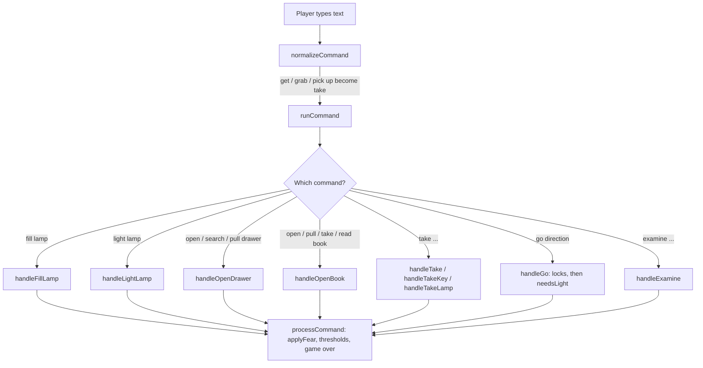
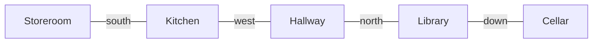

# Design Document

## Overview

This design adds a lamp puzzle, two locked rooms and a generic take command to the Haunted Adventure. It follows the style already in `game.js`: plain JavaScript, small handler functions, and immutable state updates (a handler returns a new state object and never edits the old one).

What changes for the player:

- The lamp starts empty and unlit. The player must find the oil can and the lighter, run `fill lamp` and `light lamp`, and only then can the Cellar be entered.
- A Kitchen opens east of the Hallway (needs the small brass key). A Storeroom opens north of the Kitchen (needs the rusty key).
- The brass key is hidden behind a book in the Library. The lighter and the rusty key are hidden in a Kitchen drawer. The oil can lies in the Storeroom.
- `take`, `get`, `grab` and `pick up` all work on any item lying in the room. The book is not an item: `take book`, `read book`, `pull book` and `open book` all run the same book handler, and `examine book` shows the same text as `examine shelves`.
- `open drawer`, `search drawer` and `pull drawer` all run the same drawer handler.

Design decisions, with reasons:

| Decision | Reason |
|---|---|
| Add six boolean facts at the top level of the state: `fueled`, `lit`, `kitchenDoorUnlocked`, `storeroomDoorUnlocked`, `drawerOpen`, `bookPulled`. | Matches the existing facts (`deskExamined`, `libraryEntered`). The game code owns every fact. |
| Hidden items are not in `room.items` until revealed. | Then "treat as not lying here" (Requirements 10.13 to 10.15) happens by itself. No extra checks. |
| A new `locks` setting in room data describes a locked exit. `handleGo` reads it. | One generic rule serves both doors, the same way `needsLight` serves the Cellar. |
| `get`, `grab` and `pick up` are turned into `take` inside `normalizeCommand`. Then `take book` and `read book` are turned into `open book`. | One take handler instead of many synonyms. The book is not an item, so no form of "take book" may reach the generic take. |
| The lamp examine text is chosen by a small function from `fueled` and `lit`. | The lamp text must depend only on those two facts (Requirement 4.5). |
| Reply lines from actions never go through `applyLies`. Only room descriptions, item text and arrival text do. | Keeps the "never lie" rule (Requirement 12). |
| `index.html` and `style.css` do not change. | The feature is game logic and room data only. |

Property-based testing does not apply here. The feature is a set of small text-adventure rules with a fixed number of cases, and the project rules say the developer tests in the browser. The Correctness Properties section is therefore left out, and the Testing Strategy is a manual browser checklist.

## Architecture

All changes are in `game.js`. The command flow stays the same: `processCommand` calls `runCommand`, which calls one handler, and then `processCommand` adds the fear cost, threshold lines and game over check.



The new map:



Moving east from the Hallway needs the brass key (first time only). Moving north from the Kitchen needs the rusty key (first time only). Moving down from the Library needs the lit lamp.

## Components and Interfaces

Every handler has the existing shape: `handleX(state, ...) -> { state, lines }`. If nothing changed, it returns the same `state` reference.

### normalizeCommand (changed)

1. After the filler words ("the", "a", "an") are removed and spaces are squashed, rewrite a leading `get`, `grab` or `pick up` to `take`:

   ```js
   // "get lamp", "grab key" and "pick up lamp" all become "take ..."
   text = text.replace(/^(get|grab|pick up)(\s+|$)/, "take ").trim();
   ```

   A lone `get` becomes `take`, so the existing "Take what?" reply still works.
2. Add synonyms to the existing `synonyms` list. They are checked after step 1, so `get book`, `grab book` and `pick up book` reach them as `take book`:
   - `"refuel lamp"` and `"fuel lamp"` become `"fill lamp"`
   - `"search drawer"` and `"pull drawer"` become `"open drawer"`
   - `"pull book"`, `"take book"` and `"read book"` become `"open book"`
   
   This is why `take book` never reaches the generic take branch in `runCommand`: by then it is already `open book`.
3. The old synonym entries for `get lamp`, `grab lamp`, `pick up lamp`, `get key`, `grab key` and `pick up key` can stay or be removed. They no longer match, because step 1 runs first.

`light lamp` needs no synonym, because "the" is already removed.

### runCommand (changed)

Add these branches. Place them next to the other exact-match commands, before the empty-input check:

```js
if (command === "fill lamp")   return handleFillLamp(state);
if (command === "light lamp")  return handleLightLamp(state);
if (command === "open drawer") return handleOpenDrawer(state);
if (command === "open book")   return handleOpenBook(state);
```

The existing `take lamp` branch stays. The existing `take key` branch now calls the new `handleTakeKey`. Then add, after those two (`take book` has already become `open book` in `normalizeCommand`, so it never gets here):

```js
// take <item>: pick up any item lying in this room.
if (command.startsWith("take ")) {
  return handleTake(state, command.slice(5));
}
```

### Lamp handlers (new)

`handleFillLamp(state)`. Checks run in this order:

1. Lamp not carried: unchanged, reply "lamp is missing".
2. Lamp carried, oil can not carried: unchanged, reply "oil can is missing".
3. `state.fueled` already true: unchanged, reply "already full".
4. Otherwise: return `{ ...state, fueled: true }` and reply "lamp is filled".

`handleLightLamp(state)`. Checks run in this order:

1. Lamp not carried: unchanged, reply "lamp is missing".
2. `state.lit` already true: unchanged, reply "already lit". This keeps `lit` true for the rest of the game (Requirement 1.4).
3. `state.fueled` false: unchanged, reply "no oil".
4. Lighter not carried: unchanged, reply "lighter is missing".
5. Otherwise: return `{ ...state, lit: true }` and reply "lamp is lit".

Nothing else in the code sets `fueled` or `lit`. The oil can and lighter are never removed (Requirement 1.5).

### Lamp examine text (new data and small helper)

```js
// getLampText picks the lamp text from the two lamp facts only.
function getLampText(state) {
  if (state.lit) return LAMP_TEXT.lit;
  if (state.fueled) return LAMP_TEXT.fueled;
  return LAMP_TEXT.empty;
}
```

In `handleExamine`, in the "item lying here or carried" branch, use `getLampText(state)` when `thing === "lamp"`. Use `ITEM_DETAILS[thing]` for every other item. The old `ITEM_DETAILS.lamp` ("half full") is removed, because it would contradict the empty lamp.

### handleGo (changed)

Two new checks, in this order, once `nextRoomId` is known:

1. **Locked exit.** If `room.locks` has an entry for this direction and the fact named by `unlockedFact` is false:
   - Player does not carry `keyItem`: return the same state and the lock's `lockedLine`.
   - Player carries `keyItem`: build `newState` with `[unlockedFact]: true`, keep the `unlockLine` to show first, then continue with the normal move.
2. **Light.** If `nextRoom.needsLight`:
   - Lamp not carried: the existing pitch black line.
   - Lamp carried but `!state.lit`: new refusal line "the lamp gives no light".
   - Lamp carried and lit: move on.

The lock check comes first, so a refused or unlocking move never mixes with the light rule. The key is not used up. After the door is unlocked, the fact is true and the key is no longer checked.

The unlock line is added to `lines` before the arrival and room text. It is not passed through `applyLies`. The arrival text and room description still are.

Because `handleGo` builds `newState` from `state`, setting the door fact on `newState` is one extra property in the existing spread: `{ ...state, currentRoomId: nextRoomId, [fact]: true }`.

### Take handlers (changed and new)

`handleTakeLamp(state)` stays exactly as it is.

`handleTakeKey(state)` is rewritten to mean "the key in this room". It uses a helper:

```js
// The three key items. Only one of them lies in any one room.
const ROOM_KEY_IDS = ["key", "brass key", "rusty key"];

// findRoomKey returns the key lying in this room, or undefined.
function findRoomKey(room) {
  return ROOM_KEY_IDS.find(id => room.items.includes(id));
}
```

Order of checks:

1. A key lies in the room: take it (see `takeItem` below). The Iron_Key keeps its old reply "You take the key. It is colder than the cellar."
2. Otherwise, the player carries the Iron_Key (`"key"`): "You already carry the key." (existing reply).
3. Otherwise: "There is no key here."

`handleTake(state, noun)` for everything else:

1. Turn the noun into an item id with `ITEM_NAMES` (see Data Models). If the noun is `"lamp"`, call `handleTakeLamp`. If it is `"key"`, call `handleTakeKey`.
2. Noun is not a known name: unchanged, reply "There is no <noun> here." The book is deliberately not in `ITEM_NAMES`, so it is never treated as an item. If `book` ever reached this handler, it would get this reply.
3. Item is carried: unchanged, reply "You already carry the <item>."
4. Item lies in the current room: call `takeItem`.
5. Otherwise: unchanged, reply "There is no <item> here." Hidden items land here, so the reply does not hint that they exist.

`takeItem(state, itemId, line)` is a small shared helper. It returns a new state with the item removed from the current room's `items` and added to `carriedItems`. It changes nothing else (Requirement 10.20). It is the same code as the current body of `handleTakeLamp`.

### Reveal handlers (new)

`handleOpenDrawer(state)` (reached by `open drawer`, `search drawer` and `pull drawer`):
- Not in the Kitchen: unchanged, "There is no drawer here."
- `state.drawerOpen` already true: unchanged, "The drawer is already open."
- Otherwise: a new state with `drawerOpen: true`, `"lighter"` and `"rusty key"` added to the Kitchen `items`, and the Kitchen `details.drawer` replaced by the open text. Reply with the "found" line. This is the same pattern as `handleMoveRug`.

`handleOpenBook(state)` (reached by `open book`, `pull book`, `take book` and `read book`):
- Not in the Library: unchanged, "There is no book to open here."
- `state.bookPulled` already true: unchanged, "The book is already open."
- Otherwise: a new state with `bookPulled: true` and `"brass key"` added to the Library `items`. Reply with the "found" line.

Both build the new room with `{ ...room, items: [...room.items, ...] }`, so the Library's existing rug and trapdoor changes are kept (Requirement 9.8).

### handleExamine (changed, small)

- Add aliases: `"small brass key": "brass key"`, `drawers: "drawer"`, `book: "shelves"`. With the `book` alias, `examine book` shows the same Library `details.shelves` text as `examine shelves`, before and after the book is opened.
- If the noun is `"key"` and a key lies in the room, examine that key (use `findRoomKey`). This makes "examine key" work for the new keys.
- Lamp text comes from `getLampText` (see above).

### Hints, fear and other systems (unchanged)

- `applyFear` already charges every command (except unknown and help) by the room the player was in before the command, so the new commands get the normal cost without changes (Requirement 12.5).
- `applyLies` is unchanged. `handleLook` already passes room text and item text through it, so new rooms and items can have lies in their room data.
- `isStepDone`, `getCurrentStep` and `HINT_TEXT` are unchanged (Requirement 13.6). The hints do not mention the oil can or lighter. The player can still ask for them, but the existing hint 5 ("Bring your light") does not say the lamp must be lit. This is a known gap that Requirement 13.6 asks to leave alone.
- The help text is unchanged (Requirement 13.7).

## Data Models

### New state facts

Add these to `INITIAL_STATE`, next to the other facts:

```js
// True once the lamp has been filled with oil.
fueled: false,
// True once the lamp has been lit. It never goes back to false.
lit: false,
// True once the brass key has opened the Kitchen door.
kitchenDoorUnlocked: false,
// True once the rusty key has opened the Storeroom door.
storeroomDoorUnlocked: false,
// True once the Kitchen drawer has been opened.
drawerOpen: false,
// True once the wrong book in the Library has been opened.
bookPulled: false,
```

Restart already works: `processCommand` returns `INITIAL_STATE`, and no handler ever edits `INITIAL_STATE` (they only copy it with spreads). So every new fact returns to its starting value (Requirement 13.5). The rule for new code is: never write `state.rooms.x.items.push(...)`. Always build a new array.

### Item ids

| Item | id | Starts |
|---|---|---|
| Lamp | `lamp` | Hallway (existing) |
| Iron key | `key` | Hidden in the Cellar wall (existing) |
| Small brass key | `brass key` | Hidden, appears in the Library after `open book` |
| Rusty key | `rusty key` | Hidden, appears in the Kitchen after `open drawer` |
| Lighter | `lighter` | Hidden, appears in the Kitchen after `open drawer` |
| Oil can | `oil can` | In the Storeroom `items` from the start |

Inventory already prints `"You carry a " + item + "."`, which reads correctly for all of these (Requirement 11.7).

### Name table for take

```js
// ITEM_NAMES maps what the player may type to an item id.
// "key" is not here. It is handled by findRoomKey.
const ITEM_NAMES = {
  "lamp": "lamp",
  "brass key": "brass key",
  "small brass key": "brass key",
  "rusty key": "rusty key",
  "lighter": "lighter",
  "oil can": "oil can",
  "oil": "oil can",
  "can": "oil can"
};
```

The iron key is reachable through plain `take key` only, as it is today.

### Room data

New fields on rooms:

- `locks` (new, optional). A map from a direction to a lock:

  ```js
  locks: {
    east: {
      unlockedFact: "kitchenDoorUnlocked",  // state fact that records the door is open
      keyItem: "brass key",                  // item that opens it
      lockedLine: "The east door is locked. The keyhole is small.",
      unlockLine: "The small brass key turns with a dry click, and the door swings inward."
    }
  }
  ```

- `needsLight` (existing). Still only on the Cellar.

Changes to the Hallway:

- `exits: { north: "library", east: "kitchen" }`
- `locks` as above.
- Description gains one sentence. The exact sentence "behind you the front door waits, silent and shut." stays, so the existing lie still matches:

  > ... Pale moonlight leaks through the shutters. A narrow door, swollen with damp, stands shut in the side wall. A cold draught seeps from a dark archway deeper in, and behind you the front door waits, silent and shut.

New room `kitchen` (draft text, to be adjusted while writing):

```js
kitchen: {
  name: "Kitchen",
  arrival: "Stale air and old grease. Something was cooked here a very long time ago.",
  description: "A cold kitchen, its tiles cracked and its stove long dead. A drawer hangs beneath the counter, and a narrow door waits at the far end. The way back to the hallway is behind you.",
  items: [],                       // lighter and rusty key are added by open drawer
  exits: { west: "hallway", north: "storeroom" },
  locks: {
    north: {
      unlockedFact: "storeroomDoorUnlocked",
      keyItem: "rusty key",
      lockedLine: "The north door is locked. The keyhole is crusted with rust.",
      unlockLine: "The rusty key grinds in the lock. The door opens as if it had been waiting."
    }
  },
  lies: [
    { minFear: 40,
      replaces: "The way back to the hallway is behind you.",
      text: "The way back to the hallway is only a wall." }
  ],
  details: {
    drawer: "A narrow drawer, shut tight. Something inside shifts when you touch it.",   // replaced when opened
    stove: "Cold iron, black with old soot. Nothing has burned here in years."
  }
}
```

New room `storeroom`:

```js
storeroom: {
  name: "Storeroom",
  arrival: "The storeroom is narrow and still. Your footsteps sound like someone else's.",
  description: "Shelves of empty jars line a narrow room that smells of tin and damp. The only way out is the way you came.",
  items: ["oil can"],
  exits: { south: "kitchen" },
  details: {
    jars: "Rows of empty jars, each one wiped clean on the inside."
  }
}
```

Neither room has `needsLight`, so they can be entered with no lamp, an empty lamp or a lit lamp (Requirements 6.8, 8.6). The Storeroom has no lie, which Requirement 12.2 allows.

Changes to the Library:

- `details.shelves` becomes: "The books have rotted into blocks of grey pulp. One book feels wrong, drier and heavier than the rest." (Requirement 9.2).
- No other change. `items` stays `[]`, and `open book` adds the brass key.

### Text tables

Add these next to `ITEM_TEXT` and `ITEM_DETAILS`. All are at most two sentences, cold and quiet, with no gore. The wording below is a draft for the developer to adjust.

```js
// Shown when the item lies in a room (look).
ITEM_TEXT["brass key"] = "Behind the book, a small brass key lies in the dust, bright as if freshly polished.";
ITEM_TEXT["rusty key"] = "A rusty key lies at the bottom of the drawer, its teeth gnawed by damp.";
ITEM_TEXT["lighter"]   = "A brass lighter lies in the drawer, worn smooth by many thumbs.";
ITEM_TEXT["oil can"]   = "A dented oil can sits among the jars, its spout crusted with dust.";

// Shown when the item is examined.
ITEM_DETAILS["brass key"] = "A small brass key, oddly clean. It feels warm for a moment, then cold.";
ITEM_DETAILS["rusty key"] = "A small key, orange with rust. It looks as if it fits something close by.";
ITEM_DETAILS["lighter"]   = "A battered lighter, cold to the touch. The flint wheel still spins.";
ITEM_DETAILS["oil can"]   = "A tin can with a long spout. Something still sloshes inside.";

// The lamp text depends only on the facts fueled and lit.
const LAMP_TEXT = {
  empty:  "An old oil lamp, heavy and dry. The glass is cracked, and the tank is empty.",
  fueled: "An old oil lamp, its tank full of oil. The wick is dark and waiting.",
  lit:    "An old oil lamp, burning with a small steady flame. Your shadow stands very still beside you."
};
```

In the real file these are written inside the existing object literals, not as separate assignments.

Open drawer text (replaces `details.drawer`): "The drawer hangs open and empty. The wood inside is stained in the shape of what it held."

### Reply lines

These are action results, so they are never passed through `applyLies` and never depend on fear (Requirement 12.8).

| Command | Case | Reply (draft) |
|---|---|---|
| fill lamp | filled | "You pour the oil into the lamp. It smells of old smoke." |
| fill lamp | already full | "The lamp is already full." |
| fill lamp | no lamp | "You have no lamp to fill." |
| fill lamp | no oil can | "You have no oil can." |
| light lamp | lit | "The wick catches. A small flame steadies, and the shadows step back." |
| light lamp | already lit | "The lamp is already lit." |
| light lamp | no lamp | "You have no lamp to light." |
| light lamp | not fueled | "The lamp has no oil." |
| light lamp | no lighter | "You have nothing to light it with." |
| go down | lamp not lit | "The lamp gives no light. You cannot go down into that dark." |
| open / search / pull drawer | found | "You pull the drawer open. Inside lie a brass lighter and a rusty key." |
| open / search / pull drawer | already open | "The drawer is already open." |
| open / search / pull drawer | wrong room | "There is no drawer here." |
| open / pull / take / read book | found | "You pull the wrong book from the shelf. Behind it, in a hollow, lies a small brass key." |
| open / pull / take / read book | already open | "The book is already open." |
| open / pull / take / read book | wrong room | "There is no book to open here." |
| take (item) | taken | "You take the <item>." |
| take (item) | already carried | "You already carry the <item>." |
| take (item) | not here | "There is no <item> here." |
| take key | none here | "There is no key here." |

## Error Handling

- **Unknown or misspelled commands**: unchanged. They get "That command is not recognized." and cost no fear (Requirement 12.6).
- **Missing object**: `take` alone still gets "Take what?". Wrong-room commands (`open drawer`, `open book`) get a short "not here" line and leave the state unchanged.
- **Missing tools or items**: each lamp case has its own line, and the state is returned unchanged (same reference).
- **Book commands**: `take book` and `read book` are rewritten to `open book`, so they get the book replies above, never an item reply such as "You take the book."
- **Hidden items**: `take lighter` or `take key` before the reveal gets the same "not here" reply as an item that does not exist, because the item is not in `room.items`.
- **Locked doors**: a refused move returns the same state with the locked line, and still costs fear like any other refused command (existing behavior).
- **Game over and escape**: unchanged. `processCommand` blocks every new command after game over or escape, and `restart` returns `INITIAL_STATE`.
- **Lies**: a lie only replaces a sentence in text and never touches state. Unlock lines, take lines, lamp lines and the status bar never pass through `applyLies`.
- **Malformed lock data**: not guarded. Locks are written by the developer in room data. If the key item or fact name is misspelled, the door stays locked, which shows up at once in the first browser test.

## Testing Strategy

This feature uses no automated tests and no new tooling, as the project rules say. The developer tests in the browser by opening `index.html`.

Property-based testing is not used. The rules are a small, fixed set of text cases, not functions over a wide input space.

Manual walkthrough, one line per check:

1. **Happy path.** In the Hallway: `take lamp`. `go east` (locked). Go north to the Library, `examine shelves` (then `examine book` shows the same text), `open book`, `take key` (brass), back to the Hallway, `go east` (unlock line, Kitchen). `open drawer`, `take lighter`, `take key` (rusty), `go north` (unlock line, Storeroom). `take oil can`. Then `fill lamp`, `light lamp`, `go south`, `go west`, `go north`, `go down`. Then pull the stone, take the iron key, return and `unlock door` for the escape ending.
2. **Lamp refusals.** `fill lamp` with no lamp, with no oil can, and twice in a row. `light lamp` with no oil, with no lighter, and twice in a row. `examine lamp` shows three different texts: empty, filled, lit. After `light lamp`, `fill lamp` does not turn `lit` off.
3. **Cellar light.** `go down` with no lamp gives the pitch black line. With an unlit lamp it gives the new "no light" line and the player stays in the Library. With a lit lamp the player enters, and the entry fear bonus still applies.
4. **Hidden items.** Before `open drawer`, `take lighter` and `take key` in the Kitchen fail. Before `open book`, `take key` in the Library fails. `look` does not list hidden items.
5. **Take command.** `take`, `get`, `grab` and `pick up` all work. `take the oil can`, `take oil`, `take can`, `take small brass key`, `take the rusty key` all work. Items already carried and items not in the room give the right lines. `take key` in the Cellar works as before.
   In the Library, `open book`, `pull book`, `take book`, `read book`, `get book`, `grab book` and `pick up book` each reveal the brass key the first time and say "The book is already open." afterwards. None of them says "You take the book." In the Kitchen, `open drawer`, `search drawer` and `pull drawer` all work the same way. In the wrong room, the book and drawer commands give the "not here" lines.
6. **Doors.** The doors stay open after the first unlock, even if the player drops nothing and never needs the key again. The Hallway description mentions the narrow door in the side wall (no compass word) and keeps the front door sentence.
7. **Truth and fear.** At fear 30 and above, the Hallway lie still appears. At fear 40 and above, the Kitchen lie appears, while inventory, take, fill, light and door replies stay true. The status bar shows `Room name | Fear: number`. Hints, `help` and `restart` still work, and `restart` resets lamp, doors, drawer and book.

Suggested build order, one small change at a time: state facts, then `normalizeCommand`, then the lamp commands and lamp text, then `locks` with the Kitchen and Storeroom data, then the generic take command, then the drawer and book reveals, then the Cellar light rule.
