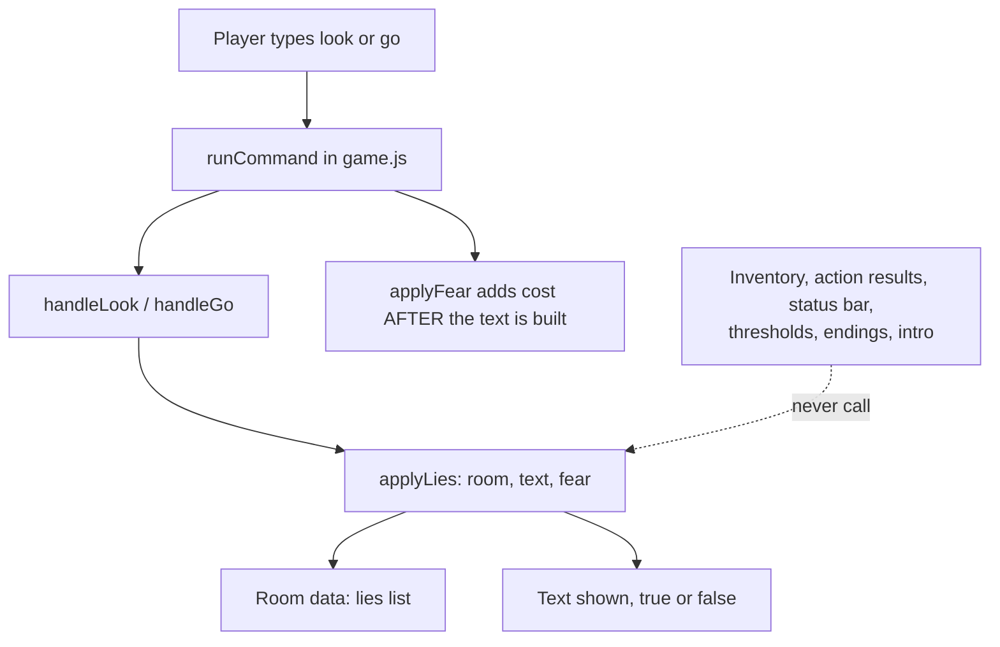

# Design Document: Lying Narrator

## Overview

When Fear is high, some room text is replaced by a false sentence. The lies are written in each room's data in `INITIAL_STATE` (game.js). One small function, `applyLies`, reads those lies and swaps the true sentence for the false one at the moment text is shown. Nothing else changes.

Key decisions:

- **Text only.** `applyLies` returns a new string. It never receives or returns a state, so it cannot change a fact.
- **Game code decides.** The lie is chosen by comparing `state.fear` to the lie's `minFear`. The narrator never chooses.
- **Fear is read before the command's cost.** `handleLook` and `handleGo` run inside `runCommand`, before `applyFear`. The state they receive still holds the old Fear, which is exactly Lie_Fear (Requirement glossary). No extra bookkeeping is needed.
- **Only description text is wrapped.** The room description, arrival text and item lines go through `applyLies`. Inventory, action results, the status bar, threshold lines, ending text and the intro never call it, so they cannot lie (Requirement 4).
- **No HTML or CSS change.** index.html and style.css stay as they are. This matches Requirement 9.6 (plain HTML, CSS, JS).

Research was not needed. The feature uses only plain JavaScript string methods already used in the project.

## Architecture



Order inside one command:

1. `processCommand` passes the old state to `runCommand`.
2. `handleLook` or `handleGo` builds the text, calling `applyLies` with `state.fear` (the old Fear).
3. `applyFear` and the threshold code run afterward and use the true state.

## Components and Interfaces

All changes are in game.js. Each is a small step that can be made one at a time.

### 1. `lies` list in room data

Each room may hold a `lies` list. A room with no list, or an empty one, shows only true text (Requirement 1.2).

Each lie has these fields:

| Field | Meaning |
|---|---|
| `minFear` | Whole number 1 to 100. The lie is active when `state.fear` is at or above it. |
| `replaces` | The exact true sentence (as written in the room text) that the lie replaces. |
| `text` | The false sentence, 1 to 200 characters. |
| `unlessCarried` | Optional item name. The lie is off while the player carries that item. |

The four lies to add, using the text already in game.js:

```javascript
// In hallway:
lies: [
  {
    minFear: 50,
    replaces: "behind you the front door waits, silent and shut.",
    text: "behind you the front door stands open to the night."
  }
]

// In library:
lies: [
  {
    minFear: 50,
    replaces: "The only light comes from the way you came in.",
    text: "The way back is bricked up. Only bare wall remains."
  }
]

// In cellar:
lies: [
  {
    minFear: 50,
    replaces: "the steps behind you lead back up.",
    text: "the steps behind you have collapsed."
  },
  {
    minFear: 75,
    replaces: "In the hollow, an old iron key lies in the dust, dull and cold, as if it has waited a long time.",
    text: "The key is already in your hand, cold against your palm.",
    unlessCarried: "key"
  }
]
```

The `replaces` text must match the real text exactly, including punctuation. If the developer edits a room sentence by hand, the matching `replaces` must be edited too. A comment above each `lies` list will say so.

The hallway line is 9 words and uses "open" and "night" (Requirement 5.2). The cellar key line uses the full key sentence from `ITEM_TEXT.key`. It is copied as a plain string because `ITEM_TEXT` is defined after `INITIAL_STATE` in the file.

### 2. `applyLies(room, text, fear, carriedItems)`

A new function placed just above `handleLook`. It returns a string.

```javascript
// applyLies swaps true sentences for false ones when fear is high.
// It only returns text. It never changes the game state.
function applyLies(room, text, fear, carriedItems) {
  // No lies list (or an empty one): show the true text.
  if (!Array.isArray(room.lies)) {
    return text;
  }

  // For each true sentence, remember the active lie with the highest minFear.
  const best = {};
  for (const lie of room.lies) {
    // Ignore a lie with a missing or wrong field.
    const valid = Number.isInteger(lie.minFear) &&
      typeof lie.replaces === "string" && lie.replaces !== "" &&
      typeof lie.text === "string" && lie.text !== "";
    if (!valid) continue;

    // Skip a lie that is not active yet, or is switched off by an item.
    if (fear < lie.minFear) continue;
    if (lie.unlessCarried && carriedItems.includes(lie.unlessCarried)) continue;

    const current = best[lie.replaces];
    if (!current || lie.minFear > current.minFear) {
      best[lie.replaces] = lie;
    }
  }

  // Replace each true sentence found in the text with its false one.
  let result = text;
  for (const replaces in best) {
    result = result.split(replaces).join(best[replaces].text);
  }
  return result;
}
```

Why these choices:

- `split(...).join(...)` is used instead of `replace` so characters such as `$` in a lie never act as special codes. It is also easy for a beginner to read.
- A sentence not found in the text is simply left alone, so a lie that matches nothing has no effect and no error (Requirement 1.5).
- Lies that replace the same sentence compete by `minFear`, and the highest wins (Requirement 1.6).
- Different sentences are replaced independently, so one active lie never hides another sentence (Requirements 2.4, 2.5).

### 3. Call sites in `handleLook` and `handleGo`

`handleLook` wraps the description and each item line:

```javascript
const lines = [applyLies(room, room.description, state.fear, state.carriedItems)];
for (const item of room.items) {
  const itemLine = ITEM_TEXT[item] || "There is a " + item + " here.";
  lines.push(applyLies(room, itemLine, state.fear, state.carriedItems));
}
```

`handleGo` wraps the arrival text before pushing it (it already calls `handleLook(newState)` for the description, and `newState` keeps the old Fear):

```javascript
if (arrival) {
  lines.push(applyLies(nextRoom, arrival, state.fear, state.carriedItems), "\u00A0");
}
```

Not changed: `handleInventory`, `handleExamine`, `handleTakeLamp`, `handleTakeKey`, `handleMoveRug`, `handlePullStone`, `handleUnlockDoor`, `handleHelp`, `processCommand`, `getThresholdLines`, `getStatusText`, `INTRO`, `ESCAPE_LINES`, `GAME_OVER_LINES`.

`handleExamine` is left alone on purpose. The requirements only name look and arrival text as lying.

## Data Models

Room data gains one optional field. No other shape changes.

```javascript
// Room (existing fields omitted)
{
  lies: [                      // optional, 0 to 10 entries
    {
      minFear: 50,             // whole number 1 to 100
      replaces: "true text",   // exact sentence in the room text
      text: "false text",      // 1 to 200 characters
      unlessCarried: "key"     // optional item name
    }
  ]
}
```

Facts the design keeps true:

- `applyLies` reads `room.lies` and never writes to it. The list keeps the same entries in the same order after every command (Requirement 3.5).
- Existing code that copies rooms with `...room` (rug and stone handlers) carries `lies` along unchanged.
- The rug and stone handlers append text to `description`. The `replaces` sentences are not touched by those additions, so the lies keep matching.
- The game state (`currentRoomId`, `carriedItems`, `fear`, `rooms[].items`, `exits`, `blocked`) is never read by `applyLies` for writing. Exits, blocked messages and takes behave exactly as before (Requirements 3.1 to 3.4, 5.5, 6.6, 7.5, 7.6, 8.5, 8.6, 8.9).

Requirement 8.8 (no key text before the stone is pulled) holds because the key line is only built for items in `room.items`, and the key is added there only by `handlePullStone`.

## Error Handling

| Situation | Result |
|---|---|
| Room has no `lies`, or it is not an array | True text is shown. No error. |
| A lie has a missing or invalid field | That lie is skipped. Other lies still work. |
| `replaces` is not found in the text | Nothing is replaced. |
| Two active lies replace the same sentence | The one with the higher `minFear` is used. |
| Fear is below every `minFear` | Text is identical to today's text (Requirement 9.5). |

`applyLies` throws no errors and shows no messages to the player.

## Testing Strategy

The project rules say the developer tests in the browser, and that no tests or syntax checks are written or run by the assistant. This design therefore adds no automated tests.

The Correctness Properties section is left out on purpose. The feature is game text inside a browser page, and the project does not use a property-testing library. The checks below cover the same ground by hand.

Manual browser checks (type `look` after each step, and watch the Fear number in the status bar):

1. **Low fear.** At Fear below 50, every room reads exactly as before. Take the lamp and look at the hallway: "silent and shut" still appears.
2. **Hallway lie.** Reach Fear 50 (for example, by repeating `look`) and type `look` in the hallway. The door is described as open to the night. Type `go south`. The reply is "The front door is locked. It will not budge." and the player stays in the hallway.
3. **Library lie.** At Fear 50 or more, go north. The arrival and the description say the way back is bricked up. Type `go south`. The player still reaches the hallway.
4. **Cellar steps lie.** Move the rug, take the lamp, and go down at Fear 50 or more. The description says the steps have collapsed. Type `go up`. The player still reaches the library.
5. **Cellar key lie.** Pull the stone, then at Fear 75 or more type `look`. The key line says it is already in your hand. Type `inventory`: the key is not listed. Type `take key`: it works. Type `look` again: no key line and no lie.
6. **Truthful text.** At high Fear, check that `inventory`, action replies, the status bar, threshold lines, game over text and escape text are unchanged.
7. **Restart.** Type `restart`. The intro and hallway text are true, and Fear is 0.
8. **Bad lie.** Temporarily change a `replaces` string so it does not match. The room shows the true text and the game keeps running. Restore it afterward.
