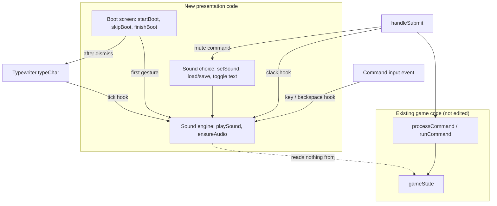
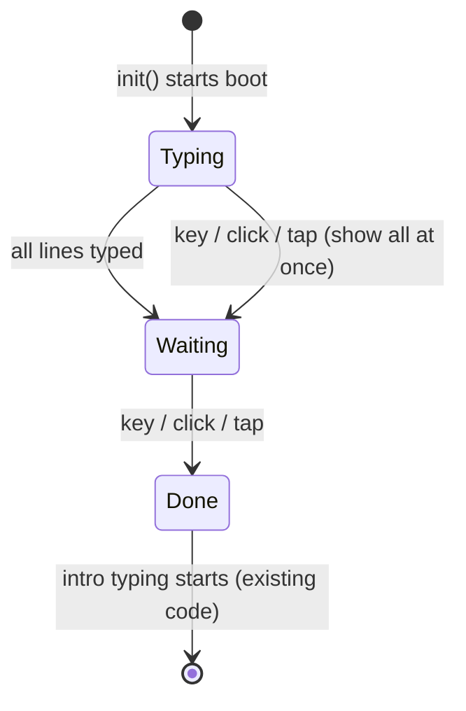
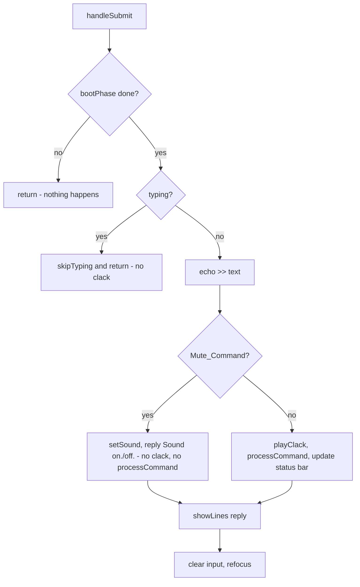

# Design Document

## Overview

This feature adds synthesized sound and a green boot screen to the Haunted Adventure page. It changes presentation only. `processCommand`, `runCommand`, `INITIAL_STATE`, fear, hints and the lying narrator are not edited.

The work touches three files:

| File | Change |
|------|--------|
| `index.html` | Add one `<button id="sound-toggle">` at the right end of `#status-bar`. |
| `style.css` | Style the toggle button and the `.boot-line` class. |
| `game.js` | Add sound constants, a small sound engine, the boot screen, and a few one-line hooks in existing functions. |

No new files, no audio files, no libraries. All sound comes from the Web Audio API (`AudioContext`, one oscillator and one gain node per sound).

### Research summary

- Browsers block audio until the player acts on the page. An `AudioContext` created before the first key press, click or tap starts `suspended`. The safe pattern is to create it inside the first gesture and call `resume()` if it is still suspended. This is why requirement 9 ties creation to the First_Gesture. See the MDN [Autoplay guide](https://developer.mozilla.org/en-US/docs/Web/Media/Guides/Autoplay_guide) and [Web Audio best practices](https://developer.mozilla.org/en-US/docs/Web/API/Web_Audio_API/Best_practices).
- Short sounds are best made with a throwaway `OscillatorNode` into a `GainNode`, using a fast decay on the gain. Nodes are garbage collected after `stop()`, so no cleanup code is needed.
- `localStorage` can throw (private mode, blocked storage), so every read and write is wrapped in `try/catch`.

Content was rephrased for compliance with licensing restrictions.

### Decisions on the open items

| Open item | Decision | Reason |
|-----------|----------|--------|
| Sound is off at load | The boot sound line reads `Sound is off. Type "sound on" to turn it on.` The flag is read once, when the boot screen starts. | Requirement 4.7. |
| A Mute_Command is submitted | **No clack plays.** The clack plays only when the page calls `processCommand`. | Requirement 3.3 says the clack is for "a command that the game runs". A Mute_Command never reaches the game. It also avoids a clack when the player has just typed "sound off". |
| Toggle clicked while the boot line is already on screen | The boot sound line is not rewritten. Only the toggle text changes. | Simplest. The line is a one-time greeting. |
| Tab key on the boot screen | Tab does not dismiss the boot screen. | Lets keyboard players reach the toggle (requirement 7.8). Every other key dismisses it. |

## Architecture

All new code lives in `game.js` in three groups: settings at the top, helper functions just before `init()`, and small hooks in existing functions.



The sound engine does not read `gameState` at all. This satisfies requirement 10.3 in the strongest way: it cannot change what it never touches.

### Boot screen flow



`bootPhase` is a separate variable from the existing `typing` flag. The boot screen never uses `typing`, `typingQueue` or `skipTyping`, so the existing typewriter code is not disturbed.

### Submit flow



## Components and Interfaces

### 1. Settings (top of game.js, before any function)

```js
// ---- Sound settings ----
const SOUND_ENABLED = true;     // starting choice when nothing is saved
const SOUND_VOLUME = 0.35;      // master volume, 0 to 1
const SOUND_MIN_GAP_MS = 25;    // minimum gap between the start of two sounds
```

Also placed here, as plain constants the developer can tune:

```js
const SOUND_STORAGE_KEY = "haunted-sound";  // saved as "on" or "off"
const BOOT_TOTAL_MS = 1800;                 // time to type all boot lines
```

### 2. Sound engine

Variables (presentation facts only):

```js
let soundEnabled = true;     // the Sound_Enabled_Flag. init() sets it from storage.
let audioCtx = null;         // the Audio_Context. null until the first gesture.
let lastSoundTime = -Infinity; // when the last played sound started (ms)
```

Functions:

| Function | Purpose |
|----------|---------|
| `ensureAudio()` | If sound is on and no context exists, create one inside `try/catch` using `window.AudioContext` or `window.webkitAudioContext`. Does nothing if the API is missing. |
| `playSound(wave, pitch, seconds, baseLoudness)` | Plays one short sound. Returns silently when any guard fails (see below). |
| `playTick(char)` | Plays a tick if `char` is not a space. Pitch and loudness are randomized. |
| `playKeyClick()`, `playBackspaceClick()`, `playClack()` | Fixed-parameter wrappers around `playSound`. |

`playSound` guards, in order, all inside one `try/catch` that swallows errors:

1. `soundEnabled` is false: return (6.10).
2. `SOUND_VOLUME` is not a finite number from 0 to 1: return (1.4).
3. `audioCtx` is null: return (no context before a gesture, 9.1).
4. Less than `SOUND_MIN_GAP_MS` since `lastSoundTime`: return (1.5).
5. If `audioCtx.state === "suspended"`, call `audioCtx.resume()` and ignore a rejected promise (9.2, 9.4).

Then it builds `oscillator -> gain -> destination`. The gain starts at `SOUND_VOLUME * baseLoudness` (1.6) and ramps down to nearly 0 over `seconds`. It sets `lastSoundTime` and stops the oscillator.

Sound table. Loudness is the `baseLoudness` before the master volume. The ordering satisfies requirements 2.3, 3.1, 3.2 and 3.3.

| Sound | Wave | Pitch (Hz) | Length | Loudness | Rule it meets |
|-------|------|-----------|--------|----------|---------------|
| Tick | triangle | 1500 x random 0.9 to 1.1 | 0.03 s | 0.25 x random 0.8 to 1.2, so 0.20 to 0.30 | 2.1, 2.2, 2.3 (max 0.30 is below key click 0.50) |
| Key click | square | 1200 | 0.05 s | 0.50 | 3.1 (above tick max) |
| Backspace click | square | 800 | 0.05 s | 0.35 | 3.2 (below key click) |
| Clack | square | 300 | 0.09 s | 0.80 | 3.3 (louder and lower than key click) |

All base loudness values are 0 to 1 inclusive.

### 3. Hooks in existing functions

Each hook is one or two lines. No existing line is removed.

| Existing function | Hook |
|-------------------|------|
| `typeChar(i)` | After `typingDiv.textContent = ...`, add `playTick(typingText.charAt(i));`. `typeChar` only runs while typing, so skipped text (`renderOutput`) and reduced-motion text never tick (2.6, 2.7). Blank lines never reach `typeChar` (2.5). Errors are swallowed inside `playSound`, so the timer chain continues (2.8). |
| `showTyped()` | At the end, add `lastInputLength = input.value.length;`. Every path that clears or changes the input calls `showTyped`, so the remembered length is always current. |
| `handleSubmit(event)` | First line of the function: `if (bootPhase !== "done") return;`. Before the boot screen is dismissed, a submit does nothing: no sound, no command, no output (5.12). Then, after the echo, detect a Mute_Command (see below). Otherwise call `playClack()` just before `processCommand`. |
| `init()` | Load the saved choice, register the sound listeners, and start the boot screen instead of typing the intro directly. |

### 4. Player typing sounds

A new `input` listener is registered in `init()` **before** the existing `showTyped` listeners, so it can compare the length before the event with the length after.

```js
// Plays a click when the player types or deletes. Uses text length, not key names.
typingBox.addEventListener("input", () => {
  if (typing || bootPhase !== "done") return;      // discarded input makes no sound (3.5)
  const now = typingBox.value.length;
  if (now > lastInputLength) playKeyClick();       // typed
  else if (now < lastInputLength) playBackspaceClick(); // deleted
  // equal length: no sound (3.7)
});
```

`lastInputLength` is a plain variable, set by `showTyped`. Classification by length alone satisfies requirement 3.4 (no key names).

A paste adds several characters in one event and plays one click. That is acceptable.

### 5. Mute commands

```js
// Returns "on", "off", or null. Does not use normalizeCommand, which would
// rewrite words. Only whitespace and letter case are cleaned up (6.4).
function getSoundCommand(text) {
  const clean = text.trim().replace(/\s+/g, " ").toLowerCase();
  if (clean === "sound off" || clean === "mute") return "off";
  if (clean === "sound on" || clean === "unmute") return "on";
  return null;
}
```

In `handleSubmit`, when `getSoundCommand` returns a value:

- Call `setSound(value === "on")`.
- The only reply line is `"Sound on."` or `"Sound off."` (6.2, 6.3, 6.6). It is shown with the usual `showLines([line, "\u00A0"])`.
- `processCommand` is not called, so `gameState`, fear, hints and the status bar stay as they are (6.1, 6.5, 6.7, 6.8).
- Setting the flag to its current value is allowed and still prints the line (6.9).
- No clack plays (open item decision above).

### 6. Sound choice and toggle

| Function | Purpose |
|----------|---------|
| `loadSoundChoice()` | Reads `localStorage` in `try/catch`. Returns `true` for `"on"`, `false` for `"off"`, otherwise `SOUND_ENABLED`. A valid saved choice wins over the constant (8.2, 8.3, 8.5). A thrown error also gives `SOUND_ENABLED` (8.4). |
| `saveSoundChoice()` | Writes `"on"` or `"off"` in `try/catch`. A failure is ignored and the flag stays in memory (8.1, 8.4). |
| `updateSoundToggle()` | Sets the button text to `SOUND: ON` or `SOUND: OFF` (7.2, 7.3). |
| `setSound(on)` | Sets `soundEnabled`, saves it, updates the toggle text, and calls `ensureAudio()` when turning on. Because `setSound` runs inside a click or submit, the context is created in the same user action (9.6). |

Toggle behavior:

- The toggle is a real `<button type="button">`. Browsers already make it focusable with Tab and activatable with Enter and Space (7.8).
- Its click handler calls `setSound(!soundEnabled)`. It writes no output lines and does not touch `gameState` (7.4, 7.5).
- The existing `document` click handler refocuses the command input after every click. For a mouse or tap that is wanted. For a keyboard activation (`event.detail === 0`) the toggle's handler calls `event.stopPropagation()` so focus stays on the button.
- The toggle works while the boot screen is showing and does not dismiss it (7.7).

### 7. First gesture and audio startup

One listener on `document`, registered in the **capture** phase for `keydown` and `click`. It runs before every other listener and removes itself after the first call. It calls `ensureAudio()`, which does nothing when sound is off (9.5). If the flag turns on later, `setSound(true)` creates the context (9.6).

`ensureAudio` is never called at page load, so no context exists before the First_Gesture (9.1).

### 8. Boot screen

Constants and variables:

```js
const BOOT_LINES = [ "HAUNTED ADVENTURE", "SYSTEM READY", <sound line>, "Press Enter or tap to skip the typing.", "PRESS ANY KEY" ];
let bootPhase = "typing";   // "typing", "waiting" or "done"
let bootDivs = [];          // the output div of each boot line
let bootTimer = null;
```

The sound line is built when the boot screen starts:

- Sound on: `Sound is on. Type "sound off" to turn it off.`
- Sound off: `Sound is off. Type "sound on" to turn it on.`

Functions:

| Function | Purpose |
|----------|---------|
| `startBoot()` | Adds the `typing` class to the form (prompt hidden). If Reduced_Motion is on, calls `skipBoot()` at once (4.8). Otherwise creates one empty `div.boot-line` per line and starts typing. |
| `typeBootChar()` | Adds one character, then schedules itself again. |
| `skipBoot()` | Stops the timer, fills every div with its full text, sets `bootPhase = "waiting"`. Runs in one step, well inside 100 ms (5.1). |
| `finishBoot()` | Sets `bootPhase = "done"`, removes the `typing` class, calls `showLines([...INTRO, "\u00A0", ...handleLook(INITIAL_STATE).lines, "\u00A0"])` (the exact call `init()` used before), and refocuses the input. |

**Timing (4.4).** The delay per character is `BOOT_TOTAL_MS / totalCharacters`, computed at start, so the whole screen takes about 1.8 s whatever the line text is. This does not reuse `TYPE_DELAY_MS`, which is 60 ms and would take about 9 s. No pauses for punctuation. With roughly 150 characters the delay is about 12 ms, which browsers honor.

**Boot input (5.1 to 5.6).** One listener on `document` for `keydown` and `click` in the capture phase:

- Does nothing when `bootPhase === "done"`.
- Ignores the event when its target is inside `#sound-toggle` (so the toggle works, 7.7).
- Ignores keydown with Ctrl, Alt or Meta held, modifier-only keys, and Tab, so browser shortcuts and keyboard focus still work.
- Ignores keydown for the function keys F1 to F12 and for Escape (`event.key` is `"F1"` to `"F12"` or `"Escape"`). It does not call `preventDefault` or `stopPropagation` for them and does not count them as "any key". They do not skip the boot typing, dismiss the boot screen or start the intro, so F5, F11, F12 and Escape keep working on the start screen (5.9, 5.10, 5.11).
- Otherwise calls `event.preventDefault()` and `event.stopPropagation()`. The key never reaches the command input, so it holds 0 characters when the intro starts (5.5). Nothing reaches `handleSubmit` or `processCommand` (5.6).
- If `bootPhase === "typing"`, calls `skipBoot()` and does not start the intro (5.2).
- If `bootPhase === "waiting"`, calls `ensureAudio()` and then `finishBoot()` within the same event, so the intro starts almost at once (5.3). If audio fails, `ensureAudio` swallows the error and the intro still starts (5.8).

**Once per load (4.10, 10.4).** `startBoot()` is called only from `init()`. `restart` goes through `processCommand` and never calls it. `soundEnabled` is not touched by restart.

**Boot lines stay above the intro (4.9, 5.4).** Boot divs are real children of `#output`. `finishBoot` only appends more lines after them.

### 9. HTML and CSS

`index.html`, inside `#status-bar` after `#status-info`:

```html
<button type="button" id="sound-toggle">SOUND: ON</button>
```

`style.css`:

```css
/* Boot screen lines are green, like the rest of the terminal text. */
.boot-line { color: #33ff66; }

/* Sound toggle: a plain button styled to fit the green status bar. */
#sound-toggle {
  font-family: monospace;
  font-size: 18px;
  color: #0a0a0a;
  background: transparent;
  border: 2px solid #0a0a0a;
  min-width: 44px;   /* tap area at least 44 x 44 px */
  min-height: 44px;
  cursor: pointer;
}
#sound-toggle:focus-visible { outline: 2px solid #0a0a0a; outline-offset: 2px; }
```

The status bar is already `display: flex; justify-content: space-between;`. Adding `align-items: center` to it keeps the title and room text vertically centered next to the taller button. The toggle is last in the markup, so it sits at the right end (7.1).

## Data Models

No game data changes. `INITIAL_STATE` and `gameState` are not edited.

New presentation-only variables in `game.js`:

| Variable | Type | Meaning |
|----------|------|---------|
| `soundEnabled` | boolean | The Sound_Enabled_Flag. |
| `audioCtx` | AudioContext or null | The Audio_Context. |
| `lastSoundTime` | number | Start time of the last played sound, in ms (from `performance.now()`). |
| `lastInputLength` | number | Command input length after the last `showTyped`. |
| `bootPhase` | `"typing"`, `"waiting"`, `"done"` | Where the boot screen is. |
| `bootDivs`, `bootTimer` | array, timer id or null | Boot typing bookkeeping. |

Saved data: `localStorage["haunted-sound"]` is `"on"` or `"off"`. Any other value is ignored.

## Error Handling

| Situation | Behavior | Requirement |
|-----------|----------|-------------|
| Web Audio API missing | `ensureAudio` returns, `audioCtx` stays null, `playSound` returns. The game runs as before. | 9.3 |
| Creating, resuming or using the context throws | Caught inside `ensureAudio` and `playSound`. No message, no state change. | 9.4, 10.6 |
| Browser blocks audio start | The intro still starts. `resume()` rejection is ignored. | 5.8 |
| `SOUND_VOLUME` not a number from 0 to 1 | `playSound` plays nothing, no message. | 1.4 |
| Sounds requested closer than `SOUND_MIN_GAP_MS` | The later request is skipped. | 1.5 |
| `localStorage` throws on read or write | Caught. The in-memory flag is used for the rest of the visit. | 8.4 |
| Saved value is not `"on"` or `"off"` | Treated as no saved value, `SOUND_ENABLED` is used. | 8.3 |

Sound errors never reach the player and never touch `gameState`.

## Testing Strategy

**Property-based testing does not apply.** The feature is audio output, DOM updates and timers, with no pure logic that benefits from generated inputs. The few pure helpers (`getSoundCommand`, `loadSoundChoice`) have a handful of meaningful cases. The project rules also say the developer tests in the browser, with no test tools and no syntax-check runs. So this design has no Correctness Properties section and no automated tests.

**Manual browser checklist** (the developer runs it by opening `index.html`):

1. Load the page. Green boot lines type in about 2 seconds and the prompt is hidden. (4.1 to 4.5)
2. Press a key during typing. All boot lines appear at once and the intro does not start. Press a key again. The intro types below the boot lines and the input holds no stray character. (5.1 to 5.5)
3. Click or tap instead of a key and get the same result. (4.6, 5.1)
4. While the intro types, hear soft ticks that skip spaces. Press Enter to skip. The ticks stop. (2.1 to 2.6)
5. Type letters, press Backspace, press Enter on a real command. Hear key click, a softer click, then a lower clack. (3.1 to 3.3)
6. Type `sound off`, then `look`. No sound, one line `Sound off.`, status bar unchanged. Type `Mute`, `  SOUND   ON  ` and `unmute` to check case and spacing. No clack on these. (6.1 to 6.9)
7. Click the toggle. Text flips, no new output line. Tab to it and press Enter and Space. (7.4, 7.5, 7.8)
8. Click the toggle during the boot screen. The boot screen stays. (7.7)
9. Turn sound off and reload. The boot sound line says off and the toggle says `SOUND: OFF`. (4.7, 8.2)
10. Type `restart`. The boot screen does not return and the sound choice is kept. (4.10, 10.4)
11. Set the OS "reduce motion" option and reload. Boot lines appear at once, with no ticks. (4.8, 2.7)
12. Type `help`, `hint`, `inventory` and a few moves with sound on and off. The replies match the game before this feature. (10.2, 10.5)
13. Set `SOUND_VOLUME` to `5`. The game runs silent with no error. (1.4)

## Requirement coverage

| Requirement | Where in this design |
|-------------|----------------------|
| 1 Settings | Settings, `playSound` guards |
| 2 Ticks | `typeChar` hook, `playTick`, sound table |
| 3 Typing sounds | `input` listener, `handleSubmit` clack hook |
| 4 Boot display | Boot screen, boot timing |
| 5 Boot input flow | Boot input listener, `finishBoot` |
| 6 Mute commands | `getSoundCommand`, submit flow |
| 7 Toggle | Sound choice and toggle, HTML and CSS |
| 8 Remembered choice | `loadSoundChoice`, `saveSoundChoice` |
| 9 Safe audio | `ensureAudio`, first gesture listener, error handling |
| 10 Presentation only | Architecture, hooks list, no edits to `processCommand` or `INITIAL_STATE` |
