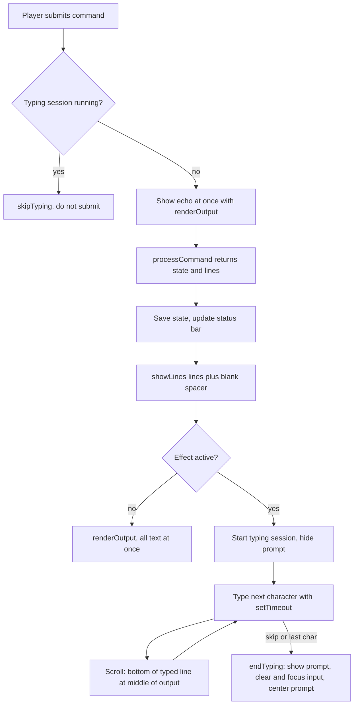
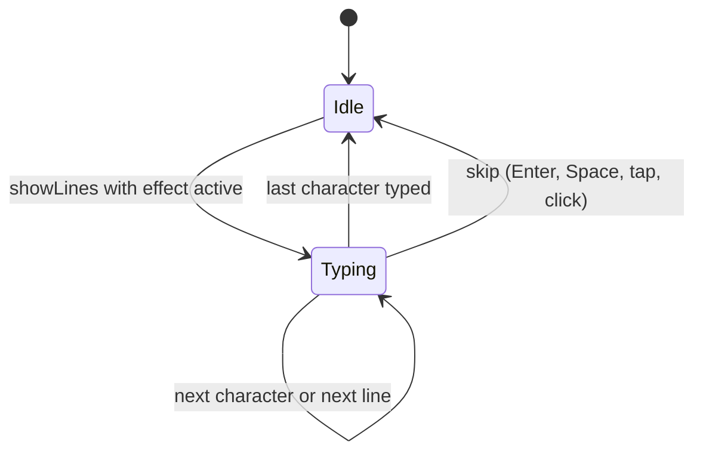

# Design Document

## Overview

This design adds a typewriter effect to the Output_Display. Game text is typed one character at a time. Blank lines and the player's own command echo appear at once. While text is typing, the prompt is hidden and commands are ignored. Enter, Space, or a tap or click on the output skips to the end.

The change is presentation-only. `processCommand`, `runCommand`, `applyFear`, `applyHintFear` and `applyLies` are not touched. The game still decides every fact. The effect only changes how already-final lines reach the screen.

The code stays plain HTML, CSS and JavaScript, with short comments for a beginner. No tests are added, as the project rules ask.

### Key design decisions

| Decision | Reason |
|---|---|
| Add a new `showLines(lines)` function and leave `renderOutput(lines)` as the instant path. | `renderOutput` already works and is used by the command echo. Keeping it means the "effect off" result is exactly the old behaviour (Req 6.2, 6.3). |
| Type with a chain of `setTimeout` calls, one per character. | Simple to read, easy to cancel for a skip, and it needs no library. |
| Hide the prompt with `opacity: 0` on `#command-form`, not `display: none` or `visibility: hidden`. | A hidden or `display: none` element loses focus, which closes the phone keyboard (Req 3.2, 3.3, 3.4). `opacity: 0` keeps layout space and focus. |
| Use `mousedown` with `preventDefault()` on `#output` while typing, and `click` to skip. | Clicking a non-focusable element normally blurs the input. Stopping `mousedown` keeps focus (Req 4.7). |
| While typing, call `preventDefault()` in `keydown` only for printable characters, Backspace, Delete, Tab, Enter and Space. Never call it when Ctrl, Alt or Meta is held. | Every other key (F5, F11, F12, Escape, the arrow keys) and every Ctrl, Alt or Meta shortcut keeps its browser behaviour, so reload and developer tools work (Req 3.6 to 3.9). Text that still reaches the input (paste, phone keyboards) is removed by an `input` listener and cleared again when the session ends (Req 3.13). |
| Keep the bottom of the typed line at the vertical middle of `#output` while typing. | When the session ends, the prompt is centered with the same rule, so the view does not jump (Req 5.2, 5.3). |
| Read `matchMedia("(prefers-reduced-motion: reduce)")` each time lines are shown. | The setting is then picked up for lines added after a change, and text already shown is never altered (Req 6.6). |

## Architecture

All new code lives in `game.js`, in the presentation section next to `renderOutput`, `showTyped` and `handleSubmit`. One small CSS rule is added to `style.css`. `index.html` does not change.





The status bar is updated before `showLines` is called, so the new room and fear show before the first character is typed (Req 7.2).

## Components and Interfaces

### Constants (top of game.js)

Declared above every function, each with a one-line comment (Req 6.1, 6.7):

```js
// Turn the typewriter effect on (true) or off (false).
const TYPEWRITER_ENABLED = true;

// Milliseconds to wait between two typed characters.
const TYPE_DELAY_MS = 10;

// Milliseconds to wait after a full stop, comma or question mark.
const PUNCTUATION_PAUSE_MS = 100;

// Milliseconds to wait after a finished line, before the next line starts.
const LINE_PAUSE_MS = 150;
```

### Typing variables

A few plain variables hold the running session. They hold presentation facts only, never game facts.

```js
let typing = false;      // true while a typing session is running
let typingTimer = null;  // the pending setTimeout, so a skip can cancel it
let typingQueue = [];    // lines still to show, not yet started
let typingDiv = null;    // the line currently being typed
let typingText = "";     // the full text of that line
```

### Functions

| Function | Job |
|---|---|
| `typewriterActive()` | Returns true only if `TYPEWRITER_ENABLED` is true, reduced motion is off, and all three delays are finite numbers from 0 to 5000 (Req 6.2, 6.3, 6.5). |
| `showLines(lines)` | The one entry point for game text. Uses `renderOutput(lines)` if the effect is not active, or if no line has text (Req 2.3). Otherwise starts a typing session. |
| `startTyping(lines)` | Sets `typing = true`, adds the `typing` class to `#command-form`, stores the lines in `typingQueue`, and calls `typeNextLine()`. |
| `typeNextLine()` | Takes the next line from the queue. A blank line (`line.trim() === ""`) is added at once and the loop continues with no delay (Req 1.8, 2.1). A text line gets an empty `div` inserted before the form, then `typeChar(0)` runs. When the queue is empty, it calls `endTyping()`. |
| `typeChar(i)` | Sets `typingDiv.textContent = typingText.slice(0, i + 1)` and calls `scrollWhileTyping()`. Then it picks the next delay and schedules the next step (see below). |
| `skipTyping()` | Cancels the timer, writes the full current line, adds every queued line with `renderOutput`, then calls `endTyping()` (Req 4.1 to 4.4). |
| `endTyping()` | Sets `typing = false`, removes the `typing` class, clears the input, redraws it with `showTyped()`, focuses it if needed, and scrolls the prompt to the middle (Req 3.11 to 3.13, 5.3). |
| `scrollWhileTyping()` | Sets `output.scrollTop` so the bottom of `typingDiv` sits at the vertical middle of `#output` (see Scrolling). |
| `scrollToPrompt()` | The existing scroll line from `renderOutput`, moved into its own function so `endTyping` can reuse it. |

Delay choice inside `typeChar(i)`:

```js
const isLast = (i === typingText.length - 1);
const ch = typingText.charAt(i);
if (!isLast) {
  // Punctuation gets a longer pause than other characters.
  const pause = ".,?".includes(ch) ? PUNCTUATION_PAUSE_MS : TYPE_DELAY_MS;
  typingTimer = setTimeout(() => typeChar(i + 1), pause);
} else if (typingQueue.length > 0) {
  // Line finished and another line follows: pause, then start it.
  typingTimer = setTimeout(typeNextLine, LINE_PAUSE_MS);
} else {
  endTyping(); // last character of the last line: show the prompt at once
}
```

The first character of a line is shown immediately. The delays apply only between characters (Req 1.3 to 1.5).

### Changes to existing functions

- **`renderOutput(lines)`**: unchanged in behaviour. Its last two lines move into `scrollToPrompt()`, and `renderOutput` calls it.
- **`handleSubmit(event)`**: first line after `preventDefault()` becomes `if (typing) { skipTyping(); return; }`. The echo still uses `renderOutput`. The reply is shown with `showLines([...result.lines, "\u00A0"])` when there are reply lines, and the existing clearing and focus lines run only if no session started. `endTyping` does the same cleanup when a session ends.
- **`init()`**: the opening `renderOutput([...INTRO, ...])` becomes `showLines([...])` with the same lines (Req 1.6). New listeners are added (below).

### New event listeners (added in `init`)

```js
// While typing: Enter or Space skips. Printable characters, Backspace,
// Delete and Tab are blocked. Every other key (F5, F11, F12, Escape, arrows)
// is left alone, and so is any key pressed with Ctrl, Alt or Meta held.
typingBox.addEventListener("keydown", (event) => {
  if (!typing) return;                       // normal behaviour (Req 4.8)
  if (event.ctrlKey || event.altKey || event.metaKey) return; // never prevented (Req 3.6)
  const key = event.key;
  if (key === "Enter" || key === " ") {
    event.preventDefault();                  // no submit, no space typed (Req 3.7, 4.5)
    skipTyping();
  } else if (key.length === 1 || key === "Backspace" || key === "Delete" || key === "Tab") {
    event.preventDefault();                  // nothing is added or removed (Req 3.8)
  }
  // Any other key falls through untouched (Req 3.9). The game never reacts
  // to it, because only the submit handler calls processCommand (Req 3.10).
});

// While typing: keep the input empty if text still gets in (paste, phone keyboards).
typingBox.addEventListener("input", () => { if (typing) typingBox.value = ""; });

// While typing: a tap or click on the output skips, and focus stays in the input.
const outputBox = document.getElementById("output");
outputBox.addEventListener("mousedown", (event) => { if (typing) event.preventDefault(); });
outputBox.addEventListener("click", () => { if (typing) skipTyping(); });
```

Outside a session, none of these listeners do anything, so Enter submits, Space types a space, and a click behaves as before (Req 4.8, 4.9). The existing `document` click handler that refocuses the input is kept.

### CSS (style.css)

```css
/* While text is typing, hide the prompt but keep its space and focus. */
#command-form.typing {
  opacity: 0;
}
```

The input is already `opacity: 0` and absolutely positioned, so it stays focusable. The form keeps its layout space and stays the last element in `#output` (Req 3.2, 5.1).

### Scrolling

- **While typing**: after each character, `scrollWhileTyping()` runs:

  ```js
  // Keep the bottom of the line being typed at the middle of the output box.
  function scrollWhileTyping() {
    const output = document.getElementById("output");
    output.scrollTop = Math.max(0, typingDiv.offsetTop + typingDiv.offsetHeight - output.clientHeight / 2);
  }
  ```

  The max with 0 keeps short content at the top without an error (Req 5.4). The browser also limits `scrollTop` to its own maximum. Because it is set after every character, a manual scroll is undone on the next character (Req 5.5).
- **When it ends**: `scrollToPrompt()` centres the prompt exactly as before (Req 5.3). The typed line's bottom was already at the middle, and the prompt sits right below it, so the view moves by at most one prompt line instead of jumping.
- **`offsetTop` reference**: `offsetTop` is measured from the element's `offsetParent`. `#output` has `position: relative` in `style.css`, so it is the `offsetParent` of the typed `div` lines and of the prompt form, and `offsetTop` is relative to the output container. This is the same assumption the existing `renderOutput` makes with `form.offsetTop`. If `position: relative` is ever removed from `#output`, `offsetTop` would be measured from a different ancestor and the scroll would be wrong. In that case the design falls back to `typingDiv.getBoundingClientRect().bottom - output.getBoundingClientRect().top + output.scrollTop` for the line bottom, which does not depend on `offsetParent`. No change is needed today, so the fallback is not added to the code.

## Data Models

There is no new game state. `gameState`, `INITIAL_STATE` and the fear number are not read or written by the typewriter.

The only new data are the four constants and the five presentation variables listed above. `typingQueue` is a plain array of strings, copied from the list passed to `showLines`, so the caller's array is never changed.

## Error Handling

| Situation | Behaviour |
|---|---|
| A delay constant is not a finite number from 0 to 5000 | `typewriterActive()` returns false and all text appears at once. Game state is untouched (Req 6.5). |
| `TYPEWRITER_ENABLED` is false | No timers start. Text appears at once, as before this feature (Req 6.2). |
| Reduced motion is on | Same as above, and it is checked on every call, so a change while the page is open applies to later lines only (Req 6.3, 6.6). |
| `window.matchMedia` is missing | Treated as "reduced motion off". Wrapped in a check so the page does not throw. |
| Empty or spaces-only command | `handleSubmit` adds no echo, `processCommand` returns no lines, and `showLines` with an empty list uses `renderOutput`, so no session starts (Req 2.3). |
| A list with only blank lines | Shown at once with `renderOutput`, with no session and no hidden prompt. |
| Enter or Space during a session | Skips. Never submits a command, and `processCommand` is not called (Req 3.5, 3.10). |
| Text sneaks into the input during a session (paste, phone keyboard) | The `input` listener clears it, and `endTyping` clears it again (Req 3.13). |
| F5, F11, F12, Escape, arrow keys or a Ctrl, Alt or Meta shortcut during a session | Not prevented. The browser handles them, and the game ignores them (Req 3.6, 3.9, 3.10). |
| Game over or escape | The ending lines are typed like any other reply, then the prompt returns within the 500 ms limit because the last line ends the session with no extra pause (Req 7.4). |

## Testing Strategy

Property-based testing does not apply to this feature, so there is no Correctness Properties section. The work is timing, DOM updates, focus and scrolling. There is no pure function with a meaningful "for all inputs" statement, and the game logic is deliberately unchanged. The project rules also say not to add tests.

The developer checks the feature by hand in the browser. Suggested checks:

1. **Basic typing**: reload the page. The intro and first room type out in order, with a longer pause after full stops, commas and question marks. Blank spacer lines appear at once.
2. **Echo and status bar**: type `look`. The `>> look` line appears instantly, the status bar updates first, then the reply types.
3. **Prompt hidden**: while text types, the prompt is invisible and the input keeps focus. On a phone, the keyboard stays open.
4. **Blocked input and browser keys**: press letters, Backspace and Tab while typing. Nothing is submitted and nothing is left in the input afterwards. Then press an arrow key, Escape, F12 and Ctrl+R. They are not blocked, so developer tools open and the page reloads, and the game does nothing for them.
5. **Skip**: press Enter, press Space, then click the output. Each shows the rest of the text at once, and the final text matches a full run.
6. **No skip when idle**: Enter submits and Space types a space. Clicking the output does nothing special.
7. **Scrolling**: with enough text to fill the screen, the bottom of the line being typed stays at the middle of the output area. Scroll up by hand while typing and the view returns on the next character. When typing ends, the prompt is centred with no visible jump.
8. **Switches**: set `TYPEWRITER_ENABLED = false`, then try a bad value like `TYPE_DELAY_MS = -1`, then turn on the browser's reduced-motion setting. Each shows all text at once.
9. **Endings**: reach game over (fear 100) and the escape. The ending lines type, then the prompt returns so `restart` works.
10. **Rules intact**: fear costs, hints, lies at high fear and the inventory reply read exactly as before.
